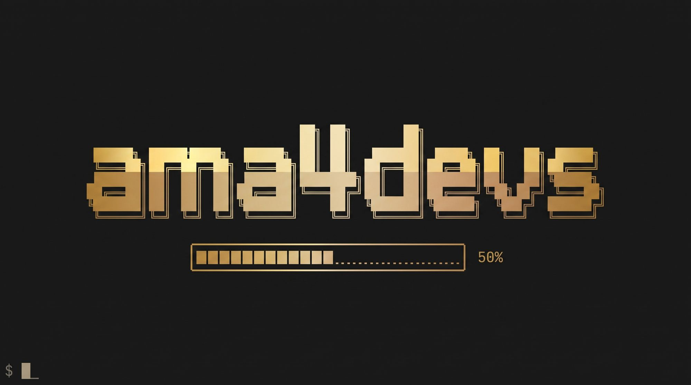
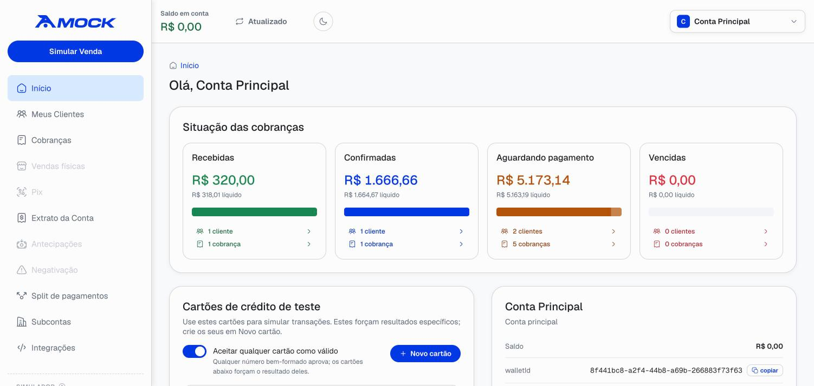
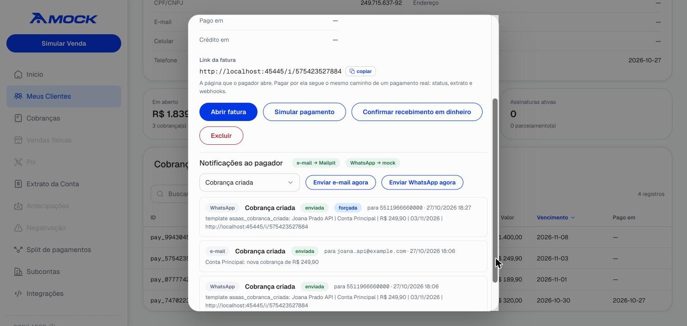
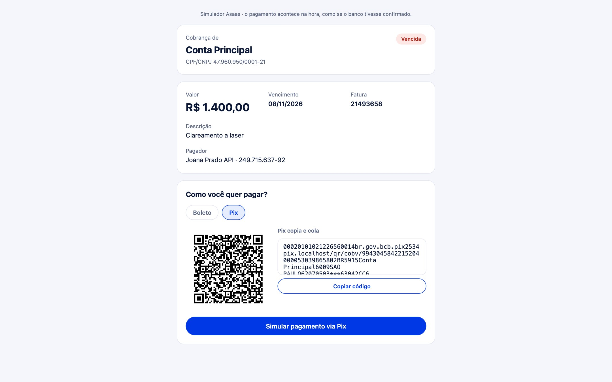
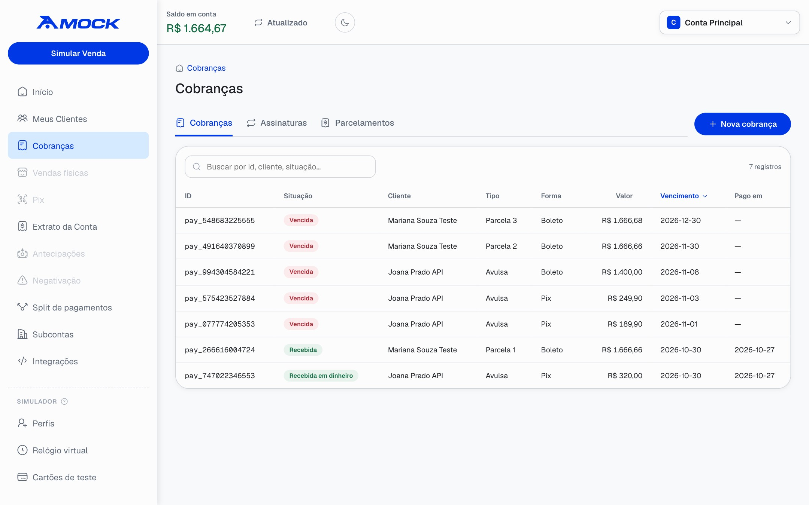
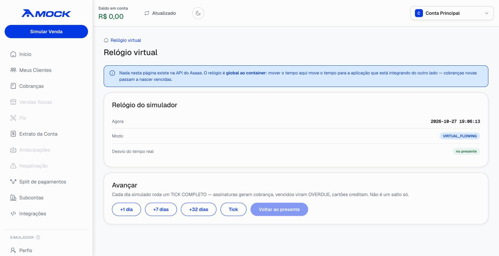

<p align="center"><b>English</b> · <a href="https://instituto-ama.github.io/ama4devs/portuguese/asaas/">Português</a> · <a href="https://instituto-ama.github.io/ama4devs/asaas/">Documentation site</a></p>

<p align="center"></p>

# Asaas Mock Server

**A local Asaas, in Docker.** The Asaas API v3 (the Brazilian payment gateway)
simulated with contract *and* behavioral fidelity: customers, charges with
**Pix**, **boleto** and **credit card**, installment plans, subscriptions,
refunds, splits, subaccounts, payer notifications, and a virtual clock. Unlike
the real sandbox, it **delivers webhooks to `localhost`**.

<p align="center">
  <a href="https://github.com/Instituto-AMA/ama4devs/pkgs/container/asaas-mock"></a>
  
  
  <a href="LICENSE"></a>
</p>

<p align="center">
  
</p>

```bash
docker run --rm -p 45445:45445 ghcr.io/instituto-ama/asaas-mock:latest
```

The API key is printed at boot. Switching your application from the sandbox to
the mock is switching the base URL:

```diff
- ASAAS_BASE_URL=https://api-sandbox.asaas.com/v3
+ ASAAS_BASE_URL=http://localhost:45445/v3
```

## Why not just use the Asaas sandbox

The sandbox does not deliver webhooks to `localhost`. That forces you into a
tunnel, a staging deploy or hand-forged payloads, and none of them tests what
matters: the credit delay, the overdue interest, the split, the webhook retry.
And on the sandbox, a card payment credits in 32 real days.

Here **time is yours**:

```bash
# A credit card payment sits at CONFIRMED; the money lands at D+32.
curl -X POST localhost:45445/_admin/clock/advance \
     -H 'content-type: application/json' -d '{"days": 32}'
# → PAYMENT_RECEIVED arrives at your endpoint. It took 40 ms.
```

## What it simulates

This is not a mock of static responses.

- **A state machine per billing type.** Pix goes straight to `RECEIVED`;
  boleto credits at D+1 business day; credit card at **D+32**; debit at D+3. An
  unpaid charge passes through `OVERDUE` first.
- **Real money.** `netValue = value − fee`, the fee is debited in the ledger,
  and the statement reconciles with the balance (a tested invariant).
- **Interest and late fees.** The fine once, on the first day overdue; interest
  pro rata die over a 30-day commercial month.
- **Split across accounts.** Every API key is an account with its own
  `walletId` and balance. A split moves money and posts entries to **both**
  statements.
- **Webhooks the way Asaas sends them.** `asaas-access-token` header, **only HTTP
  200 counts** (201 and 204 are failures, the real rule), 15-attempt backoff,
  `SEQUENTIALLY` with real head-of-line blocking, and `interrupted` at the end.
- **Real card handling.** Tokenization (the PAN is never stored), test cards,
  pre-authorization and capture, chargeback. Card installments charge the card.
- **A subscription charges its saved card by itself, with Asaas's retries.** On the
  due date the card is tried at 08:00, 14:00 and 20:00, and three more times the
  next day. Every refusal is a `PAYMENT_CREDIT_CARD_CAPTURE_REFUSED` webhook while
  the charge stays `PENDING`; when the schedule runs out it goes `OVERDUE` and is
  not tried again. A new card on the subscription (`PUT /v3/subscriptions/{id}/creditCard`) is used by
  the pending charges. Make a saved card approve N more charges and then decline
  (panel, or `PUT /_admin/credit-cards/:token`): skip months on the clock and watch
  three invoices get paid, the fourth refused six times, and your state machine
  react. The schedule is configuration (`CARD_CAPTURE_SCHEDULE`, or the panel).
- **Recurrence.** A subscription creates its **first charge on creation**; the
  next ones are born 40 days before their due date. In an installment plan the
  rounding remainder goes to the **last** installment, and on a card each one
  credits at **D+32×n**. *(All three captured from the real sandbox, all three
  contradict what the docs suggest.)*
- **Pix that actually pays.** `GET /v3/payments/{id}/pixQrCode` returns a **real
  EMV BR Code** with CRC16 and the QR image: a phone camera reads it.
- **Subaccount onboarding.** Create the subaccount, list the pending KYC
  documents, upload the file (multipart), approve it.
- **The whole API surface.** Every operation of the official specification
  exists, with authentication, validation and the Asaas error format. Those
  without a business engine answer `501` naming the operation, never fake data
  (`GET /_admin/coverage`).

## Payer notifications

What Asaas tells the person who pays, delivered for real on your machine:

<table>
<tr>
<td width="56%"></td>
<td>

- Every charge event (created, updated, due soon, overdue, received) sends the
  payer an **e-mail to Mailpit**, a **WhatsApp template** through the
  [WhatsApp mock](../whatsapp/)'s Cloud API, and an **SMS** to the
  [SMS mock](../sms/) (sender `ASAAS`), which it finds by itself at
  `sms:8899` (or `sms-mock:8899`).
- **An installment plan is told once**: the first installment's creation tells
  the whole plan (*R$ 3.000,00 em 5x de R$ 600,00*); reminders and payment
  notices stay per installment.
- The [generator mock](../generator/) is found the same way: on boot and every 10 s
  at `generator:45450` (or `generator-mock:45450`), on this machine and on the Docker
  host; while reachable, the panel's **Integrations › Generator** tab lets you open it or
  populate the selected account with customers, charges, and confirmed payments.
- Everything comes up configured: on boot and on every tick the sender number
  gets this server's webhook and the payer templates are created in the
  WhatsApp mock, through Meta's own calls.
- Every customer is born with Asaas's eight default notification settings
  (`GET /v3/customers/{id}/notifications`, changed with `PUT /v3/notifications/batch`),
  with e-mail, SMS and WhatsApp all on here (Asaas starts WhatsApp off). The
  due-date warning goes out N days before (10 by default) and on the due day; an
  overdue charge is told again every N days (7 by default) while unpaid; a
  subscription's charge is not told on creation.
- The customer's `notificationDisabled` and each setting are honored (the SMS
  needs a mobile phone on the customer), a failing channel never blocks the
  charge, and the panel resends on demand.

</td>
</tr>
</table>

## The panel

Open **http://localhost:45445**. It is not the Asaas dashboard: it is the
*simulator's*, and it shows what Asaas will not let you see.

<table>
<tr>
<td width="50%"><br><sub><b>The invoice page.</b> What the payer opens (<code>invoiceUrl</code>): Pix with a real QR code, boleto with the digitable line, or card. Paying there runs the real path: status, statement, webhooks.</sub></td>
<td width="50%"><br><sub><b>Charges.</b> Single charges, installments and subscriptions, with their status, billing type and due date. <b>New charge</b> creates any of the three.</sub></td>
</tr>
<tr>
<td width="50%"><br><sub><b>Virtual clock.</b> <code>+1 dia</code>, <code>+7 dias</code>, <code>+32 dias</code>: every simulated day runs a full tick, so subscriptions charge, unpaid charges go overdue and cards credit.</sub></td>
<td width="50%"></td>
</tr>
</table>

- **Customers**: create, edit, remove and restore; open one to see everything
  billed to it. The new-customer form has a button that fills every field with
  test data (name, a valid CPF, contact, address), besides the CPF-only one.
- **Charges**, **Subscriptions**, **Installment plans**, and **New charge** with
  the three kinds Asaas offers (single, installments by total or per
  installment, subscription), any billing type, interest, fine, discount and
  split. **Simulate sale** opens the same form. A button fills the form with a
  random billing type, value, due date and description, and creates a test
  customer first when none is selected.
- **A charge**: its invoice link, simulate the payment, confirm a cash receipt,
  receive, overdue, refund, delete, restore, and its notifications.
- **Integrations**, per account: API keys (generate, rotate, expire on the
  virtual clock), webhooks (with the event checklist, through the real
  `/v3/webhooks`), request logs (every `/v3` call, with what went in and what
  came back, errors included), webhook logs with your endpoint's answer (and the
  events no webhook took), the e-mail, WhatsApp and SMS channels, and the generator.
- **Test cards**: the table the engine reads; accept any well-formed card or
  only the listed ones; add a card with the outcome it forces.
- **Invoices** (NFS-e, *notas fiscais*): schedule a note for a charge, issue it, cancel it,
  and register the account's fiscal information. The city hall answers on the
  next tick (`SYNCHRONIZED` → `AUTHORIZED`, or `ERROR` without fiscal
  information), or now with the simulator's buttons; an authorized note's
  `pdfUrl` and `xmlUrl` open its document. A subscription with
  `invoiceSettings` gets a note for each charge.
- **Profiles**: one root account per tenant of your application, created and
  deleted without a restart. **Reset** empties one and keeps its id and keys:
  everything, or only the charges, notes and logs, keeping customers and
  subaccounts; cancelling first goes through the API, so your webhooks hear
  `PAYMENT_DELETED`, `SUBSCRIPTION_DELETED` and `INVOICE_CANCELED` before the
  delete.

## Use it in your project

```yaml
services:
  asaas:
    image: ghcr.io/instituto-ama/asaas-mock:0.11.4   # pin a version, or :latest
    ports:
      - '45445:45445'
    environment:
      # Pin the key, otherwise a fresh volume generates a new one.
      # `$$` is a literal `$` in compose: a single `$aact_...` would become an empty variable.
      ASAAS_API_KEY: '$$aact_hmlg_local'
      # Inside the container localhost is the container: this sends webhooks to your machine.
      WEBHOOK_LOCALHOST_REWRITE: host.docker.internal
      # Time flows, and you can skip ahead (POST /_admin/clock/advance).
      CLOCK_MODE: VIRTUAL_FLOWING
    extra_hosts:
      - 'host.docker.internal:host-gateway'   # Linux
    volumes:
      - asaas-data:/data
volumes:
  asaas-data:
```

If your application runs in the same compose network, it reaches the mock at
`http://asaas:45445/v3`. **In CI**, drop the rewrite and use
`CLOCK_MODE=VIRTUAL_FROZEN`: the clock only moves when the test says so.

```bash
curl localhost:45445/v3/customers \
  -H 'access_token: $aact_hmlg_local' -H 'content-type: application/json' \
  -d '{"name":"Jane Doe","cpfCnpj":"24971563792","email":"jane@example.com","mobilePhone":"11987654321"}'
```

To get the payer notifications, run the [WhatsApp mock](../whatsapp/), Mailpit
and the [SMS mock](../sms/) next to it. Nothing to set: this server finds them
by itself, however it runs (bun, `docker run`, your compose, the root
[`docker-compose.yml`](../../docker-compose.yml)). It looks for them by the
compose service name (`mailpit:8025`, `whatsapp:3010` or `whatsapp-mock:3010`,
`sms:8899` or `sms-mock:8899`), on this machine (`localhost`) and on the Docker
host (`host.docker.internal`, the gateway on Linux), on boot and every 10 s, and
the closest one wins. The address the WhatsApp mock calls back on (delivery
statuses, the payer's replies) is found the same way: each one this server may
be reached on is offered, and the first the WhatsApp mock verifies is kept. A
variable below pins a place; set empty, it turns that channel off. The SMS mock
is found the same way (port 8899, the one that answers `GET /health` with
`service: "sms"`), and the payer SMS goes to it. The
[generator mock](../generator/)
is found the same way (port 45450); while reachable, **Integrations › Generator**
lets you open it or populate the selected account.

## Configuration

| Variable | Default | |
|---|---|---|
| `PORT` | `45445` | HTTP port |
| `ASAAS_API_KEY` | *generated, printed at boot* | The main account's key |
| `WEBHOOK_LOCALHOST_REWRITE` | *(empty)* | Host that replaces `localhost` in webhook URLs. **Use `host.docker.internal`.** |
| `CLOCK_MODE` | `REAL` | `REAL` · `VIRTUAL_FLOWING` (flows, you can skip) · `VIRTUAL_FROZEN` (moves only when told, for CI) |
| `ADMIN_ENABLED` | `true` | The `/_admin/*` routes and the panel |
| `INVOICE_BASE_URL` | `http://localhost:<PORT>` | Where `invoiceUrl` and `bankSlipUrl` point, as the browser reaches this server |
| `MAILPIT_URL` | *(unset: found by itself)* | Mailpit for the payer e-mails; set empty, e-mail is off |
| `WHATSAPP_MOCK_URL` | *(unset: found by itself)* | The WhatsApp mock for the payer templates; set empty, WhatsApp is off |
| `SMS_MOCK_URL` | *(unset: found by itself)* | The SMS mock for the payer SMS; set empty, SMS is off |
| `SMS_UI_URL` | `http://localhost:8899` | The SMS mock's panel as the browser reaches it (reported in `/_admin/notify/status`) |
| `GENERATOR_URL` | *(unset: found by itself)* | The generator mock for fake Brazilian data and account population; set empty, generator is off |
| `GENERATOR_UI_URL` | `http://localhost:45450` | The generator screen, as the browser opens it from Integrations |
| `WHATSAPP_PHONE_NUMBER_ID` | `5511400000000` | The sender number in the WhatsApp mock |
| `WHATSAPP_WABA_ID` | `100000000000001` | The WABA whose library holds the payer templates |
| `NOTIFY_CALLBACK_BASE_URL` | *(unset: found by itself)* | This server as the WhatsApp mock reaches it |
| `MAILPIT_UI_URL` · `WHATSAPP_UI_URL` | `http://localhost:8025` · `http://localhost:3010` | The two UIs, as the browser opens them from Integrations |
| `NOTIFY_FROM_EMAIL` | `notificacoes@asaas.localhost` | Sender of the e-mails |
| `CARD_CAPTURE_SCHEDULE` | `0@08:00,0@14:00,0@20:00,1@08:00,1@14:00,1@20:00` | When a recurring card charge is tried: days after the due date @ local time. Asaas's own account (blog.asaas.com, 2024) is the default; the panel overrides it at runtime |
| `DATABASE_PATH` | `/data/asaas.db` | Mount a volume at `/data` to persist |
| `TZ` | `America/Sao_Paulo` | |

## Admin endpoints

They do not exist in Asaas: outside `/v3`, no `access_token`, off with
`ADMIN_ENABLED=false`.

| | |
|---|---|
| `GET /_admin/clock` · `POST /_admin/clock/advance` · `POST /_admin/clock/set` | The clock: where it is, `{"days": 32}`, `{"date": "2026-08-01"}` |
| `POST /_admin/tick` | Run the jobs without moving the clock |
| `GET /_admin/accounts` · `POST /_admin/accounts` · `DELETE /_admin/accounts/:id` | Accounts with balance and a working key; new profile; delete with everything it owns |
| `POST /_admin/accounts/:id/reset` | Empty a profile and keep its id and keys: `remove` picks the groups (`customers`, `subaccounts`, `charges`, `invoices`, `webhooks`, `logs`); `cancelCharges` first sends `PAYMENT_DELETED` / `SUBSCRIPTION_DELETED` / `INVOICE_CANCELED` through the API path |
| `GET`, `POST /_admin/accounts/:id/keys` · `POST …/keys/:keyId/rotate` · `PUT`, `DELETE …/keys/:keyId` | API keys |
| `GET /_admin/webhooks/events` · `GET /_admin/webhooks/deliveries` · `POST /_admin/webhooks/pause` | Webhook events, the delivery log, freeze the dispatcher |
| `GET /_admin/test-cards` · `PUT /_admin/test-cards/policy` · `POST`, `DELETE /_admin/test-cards…` | Test cards and the accept-any policy |
| `GET /_admin/credit-cards` · `PUT /_admin/credit-cards/:token` | Saved cards; `{"outcome": "DECLINE"}` or `{"approvalsLeft": 3}` (approve 3 more, then decline) |
| `GET`, `PUT /_admin/card-capture/schedule` | The retry schedule of recurring card charges, `{"schedule": "0@08:00,1@08:00"}`; `""` is Asaas's default |
| `GET`, `POST /_admin/notifications` · `GET /_admin/notify/status` · `GET /_admin/notify/arrivals` · `POST /_admin/notify/test` | Payer notifications: sent, resend, channel health, what arrived |
| `GET /_admin/coverage` · `GET /_admin/fees` | Operations with an engine; the fee table |
| `POST /_mock/invoices/:id/authorize` · `…/error` · `…/confirm-cancellation` · `…/deny-cancellation` | The city hall's answer to a note now, instead of on the next tick: authorize (fiscal information or not), refuse with `{"description": "…"}`, cancel or refuse to cancel |

## Fidelity: proven, not promised

The business rules were **captured from the real Asaas sandbox** and are checked
field by field by a parity suite:

```bash
bun run test:parity
```

`tools/capture.ts` runs the scenarios against the real Asaas and records the
answers in `tests/golden/`; the suite replays them against the simulator and
compares everything that is not legitimately volatile, down to **the exact set
of keys of each object**. The capture knocked down 20 rules deduced from the
documentation, among them: a subscription creates its first charge at once; the
card installment fee comes off the total and the division truncates (R$ 350 in
12x is R$ 1,20 of fee per installment, not R$ 1,21); installment `n` credits at
D+32×n; the discount field is `limitDate`, which the specification does not
declare.

The calls a real application makes to Asaas were also exercised against the
simulator and compared key by key with the sandbox, which found six holes a
contract suite could not see (the Pix QR code, installments through
`POST /v3/payments`, paying with an already tokenized card…). See
`progress.md`.

To capture again with your own **sandbox** key (the script refuses any key that
does not start with `$aact_hmlg_`):

```bash
ASAAS_SANDBOX_API_KEY='$aact_hmlg_…' bun run capture
bun run test:parity
```

## Development

```bash
bun install
bun run codegen        # OpenAPI spec → TypeBox and the manifest of operations
bun run db:generate    # migrations from the Drizzle schema
bun run dev
bun test
bun run e2e            # boots the server, pays a Pix charge, waits for PAYMENT_RECEIVED
bun run spec:diff      # did Asaas change the API?
```

Read [`AGENTS.md`](AGENTS.md) before contributing: pure domain, no `Date.now()`,
money in integer cents. Project state: `progress.md`.

## License and disclaimer

MIT, see [LICENSE](LICENSE).

**Not affiliated with Asaas.** An independent simulator of their public API, for
local development and testing. "Asaas" is a trademark of its owners. **Do not
use it to move real money**: no payment here is real.
