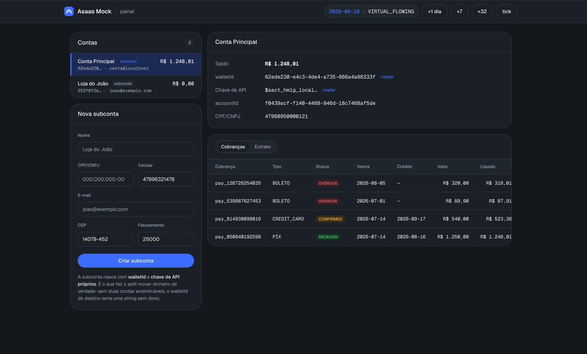

# Asaas Mock Server: a local Asaas API sandbox simulator

A mock of the **Asaas API v3** (the Brazilian payment gateway) for local
development, automated tests and CI: customers, charges with **Pix**,
**boleto** and **credit card**, installments, subscriptions, refunds, splits,
webhooks delivered to `localhost`, payer e-mail and WhatsApp notifications,
and a virtual clock to travel through due dates.

```bash
docker run --rm -p 45445:45445 ghcr.io/instituto-ama/asaas-mock:latest
# panel: http://localhost:45445 · API: http://localhost:45445/v3
```

Em português: simulador local do Asaas (sandbox) com Pix, boleto, cartão,
parcelamento, assinatura e webhooks entregues no `localhost`.

A **local Asaas**, in Docker. It simulates the Asaas sandbox with contract *and*
behavioral fidelity — and, unlike the real sandbox, it **delivers webhooks to
`localhost`**.

<p align="center">
  
  <a href="LICENSE"></a>
</p>

```bash
docker run -p 45445:45445 ghcr.io/instituto-ama/asaas-mock
```

**Image:** [`ghcr.io/instituto-ama/asaas-mock`](https://github.com/Instituto-AMA/ama4devs/pkgs/container/asaas-mock)
on GHCR — `linux/amd64` and `linux/arm64`. Tags: the `package.json` version (never
moves; pin it), `sha-<commit>` and `latest`. The `publish-mocks` workflow publishes
it on every push to master that changes this directory; see the root README.

<p align="center">
  
</p>

<p align="center">
  <em>The clock reads <code>2026-08-16</code> because someone clicked <code>+32</code>. That's the
  whole point: the boleto is <code>OVERDUE</code>, the card credits at D+32, and none of it took
  a month.</em>
</p>

## Use it in another project

Don't clone this repository. Paste this into your application's `docker-compose.yml`:

```yaml
services:
  asaas:
    image: ghcr.io/instituto-ama/asaas-mock:0.5.0
    ports:
      - '45445:45445'
    environment:
      # Pin the key, otherwise it changes on every `docker compose down -v` and
      # your application's .env stops matching.
      #
      # The `$$` is NOT a typo: compose interpolates `$`, so a `$aact_...` would
      # become an empty variable and the container would boot with a different
      # key — with no error anywhere, and you'd lose the afternoon. `$$` yields
      # a literal `$`.
      ASAAS_API_KEY: '$$aact_hmlg_local'

      # THE LINE THAT MAKES THIS WORK. Inside the container, "localhost" is the
      # CONTAINER ITSELF: a webhook to http://localhost:3000 would hit the mock,
      # not your app. This rewrites the host so the event reaches your machine.
      WEBHOOK_LOCALHOST_REWRITE: host.docker.internal

      # Time flows normally, but you can skip ahead (POST /_admin/clock/advance).
      # Without this, waiting for a card's D+32 takes 32 real days.
      CLOCK_MODE: VIRTUAL_FLOWING
    extra_hosts:
      - 'host.docker.internal:host-gateway' # required on Linux
```

And in your application, switching environments is switching the base URL:

```diff
- ASAAS_BASE_URL=https://api-sandbox.asaas.com/v3
+ ASAAS_BASE_URL=http://localhost:45445/v3
+ ASAAS_API_KEY=$aact_hmlg_local
```

If *your* application also runs in Docker on the same compose network, its host
for reaching this one is the service name — `http://asaas:45445/v3`, not
`localhost`.

**In CI**, drop `WEBHOOK_LOCALHOST_REWRITE` and `extra_hosts` (both services
already see each other over the compose network) and use
`CLOCK_MODE=VIRTUAL_FROZEN`, which only moves when you tell it to — that's what
makes the test deterministic.

## Develop the simulator itself

```bash
git clone … && cd asaas-mock-server
docker compose up      # builds the local code, doesn't pull from the registry
```

## ⚠️ Read this before anything else

Inside the container, **`localhost` is the container itself**. A webhook pointed
at `http://localhost:3000` would hit the simulator, not your application.

That's why the `docker-compose.yml` ships with:

```yaml
environment:
  WEBHOOK_LOCALHOST_REWRITE: host.docker.internal
extra_hosts:
  - 'host.docker.internal:host-gateway'   # makes it work on Linux too
```

The host of any webhook URL pointing at `localhost`/`127.0.0.1` gets rewritten,
and the event reaches your machine. This is the reason the project exists. If you
turn it off, know why.

## Why not just use the Asaas sandbox

The sandbox doesn't deliver webhooks to `localhost`. That forces you into ngrok,
into deploying a staging environment just to test, or into hand-forging payloads —
and none of that tests what matters: the credit delay, the overdue interest, the
split, the webhook retry.

Also, here **time is yours**:

```bash
# create a credit card payment → it sits at CONFIRMED
# the money only lands at D+32. On the real sandbox, you wait 32 days.
curl -X POST localhost:45445/_admin/clock/advance \
     -H 'content-type: application/json' -d '{"days": 32}'
# → PAYMENT_RECEIVED arrives at your endpoint. It took 40ms.
```

## What it actually simulates

This is not a mock of static responses.

- **A state machine per billing type.** Pix goes straight to `RECEIVED` (skipping
  `CONFIRMED`); boleto credits at D+1 business day; credit card at **D+32**; debit
  at D+3. An unpaid one passes through `OVERDUE` first.
- **Real money.** `netValue = value − fee`. The fee is debited in the ledger. The
  statement reconciles with the balance — there's a tested invariant for that.
- **Interest and late fees.** The fine is applied once, on the first day overdue;
  interest is pro-rata die over a 30-day commercial month.
- **Split across accounts.** Every API key is an account with its own `walletId`
  and balance. A split moves money and posts entries to **both** statements.
- **Webhooks the way Asaas does them.** `asaas-access-token` header, **only HTTP
  200 counts as success** (201 and 204 are failures — that's the real rule),
  15-attempt backoff, `SEQUENTIALLY` with genuine head-of-line blocking, and
  `interrupted` at the end.
- **Real card handling.** Tokenization (the PAN is never stored), test cards,
  pre-authorization and capture, chargeback. Card installments charge the card.
- **Recurrence.** A subscription generates its **first payment on creation** (and
  advances the cycle); the rest are born 40 days before the due date. For
  installments, the rounding remainder goes into the **last** one, and on a card
  each installment credits at **D+32×n** — staggered, not all at once. *(All three
  rules were captured from the real sandbox; all three contradict what the docs
  suggest.)*
- **Pix that actually pays.** `GET /v3/payments/{id}/pixQrCode` returns a **real
  EMV BR Code** — with CRC16 — and the QR PNG. Point your camera at it: the phone
  reads it. (The test decodes the image back; a QR that merely *looks* like a QR
  doesn't pass.)
- **Subaccount onboarding.** Create the subaccount, list the pending KYC
  documents, upload the file (multipart), and approve it — no waiting for a human
  reviewer.
- **The whole API surface.** All 213 operations from the official spec exist, with
  authentication, validation, and the Asaas error format. **119 have a business
  engine**; the rest return `501` naming the missing operation — never fake data.

## Dashboard

Open **`http://localhost:45445`**. It's not the Asaas dashboard — it's the
*simulator's* dashboard, and it shows what Asaas won't let you see:

- **Every account with its balance**, the main one and the subaccounts, side by
  side. Each with its `walletId` and its **API key** (copyable) — something the
  real API would never hand you, and which here is the whole point: it's how you
  step into a subaccount.
- **Create a subaccount** from a form. It's born with its own wallet and key.
- **Profiles** (Simulador → Perfis): create and delete ROOT accounts — one per
  tenant of your app — without a restart. A delete removes everything the
  profile owns, subaccounts included. A profile seeded by the environment
  (`ASAAS_API_KEY`, `SEED_EXTRA_ACCOUNTS`) comes back, empty, on the next boot.
- **Integrações**, per account, like the Asaas dashboard: **Chaves de API**
  (generate, rotate, disable, delete, expire on the virtual clock — the old key
  is a 401 on the next request), **Webhooks** (add and edit with the event
  checklist, auth token, send type and queue switch, all through the real
  `/v3/webhooks`) and **Logs de Webhooks** (each delivery, your endpoint's
  answer and the frozen payload). "Segurança" and "Logs de Requisições" are
  drawn disabled: not built yet.
- **Meus Clientes**: create and edit customers ("Gerar CPF" fills a valid test
  CPF), remove and restore them, and open one to see everything billed to it:
  its charges, subscriptions and installment plans, with open and received totals.
- **Cobranças**, in three tabs — Cobranças, Assinaturas, Parcelamentos — and a
  **Nova cobrança** form with the three kinds Asaas offers: a single charge
  (`POST /v3/payments`), an installment plan by total or per installment
  (`POST /v3/installments`) and a subscription with its cycle and end
  (`POST /v3/subscriptions`), any billing type including "Pergunte ao cliente",
  with interest, fine, discount and a split to another account; "Cliente de
  teste" creates a customer with a valid CPF in one click. The sidebar's
  **Simular Venda** opens this same form. When it is done it lists every invoice
  it generated, month by month, each with its link. A click opens a charge: its invoice link,
  **Simular pagamento** (sandbox confirm), **Confirmar recebimento em dinheiro**
  and its undo, delete and restore, plus the simulator's receive, overdue and
  refund. A subscription or plan opens with its charges and can be removed (a
  plan's pending charges cancelled).
- **The invoice page** (`invoiceUrl`, `/i/<id>`; `bankSlipUrl` opens it on the
  boleto tab): the page the payer opens, served by this server. It shows the
  charge, the installments of its plan and how to pay — Pix (QR code and copy and
  paste), boleto (digitable line) or card (a test card decides the outcome),
  only the methods the charge accepts ("Pergunte ao cliente" offers all three).
  A card on an installment invoice is "parcelado no cartão": every pending
  installment is confirmed at once and credited in its month.
  Paying there runs the same path as a real payment: status, statement and
  webhooks. Set `INVOICE_BASE_URL` when the browser reaches the server on another
  address than `http://localhost:<PORT>`.
- **Payer notifications**: what Asaas tells the person who pays. With
  `MAILPIT_URL` and `WHATSAPP_MOCK_URL` set, every charge event (created,
  updated, overdue, received or confirmed) sends the payer an e-mail, which lands
  in Mailpit, and a WhatsApp template (`asaas_*`, in the WhatsApp mock's
  `templates/`), which shows in its console. They go through an outbox delivered
  with the webhooks, so a failing channel never blocks the charge. The customer's
  `notificationDisabled` and its notification settings are honored. The charge
  dialog lists what was sent and has **Enviar e-mail agora** and **Enviar
  WhatsApp agora** to force one, the due-date reminder included.
  Everything comes up configured: on boot, and again on every tick if the
  WhatsApp mock was not up yet or restarted, the sender number is registered in
  the WhatsApp mock with this server's webhook (`/_mock/whatsapp/webhook`), which
  records the delivery statuses and the payer's replies; a registration someone
  changed by hand is kept. **Integrações › WhatsApp** and **› E-mail (Mailpit)**
  show whether each channel answers, what was sent, what actually arrived there
  (read back from Mailpit and the WhatsApp mock), the WhatsApp statuses and
  replies, **Enviar teste**, and a button to open Mailpit or the WhatsApp console.
- **Test cards** (Início and Simulador → Cartões de teste): the table the engine
  reads. **"Aceitar qualquer cartão como válido"** on (the default, as Asaas): an
  unlisted well-formed number approves; off: only the listed cards pass and any
  other number is refused by the issuer. **Novo cartão** adds a card with the
  outcome it forces (approve, issuer refusal, refusal only when charged, expired,
  invalid number) and a label of your own — a typed number, or one generated with
  a valid Luhn digit for a brand. Added cards can be removed; they are offered on
  the invoice page too.
- **Payments and statement per account.** Click a subaccount and see that it's
  genuinely isolated: it can't see the parent's payments, but the split credit is
  there.
- **Time travel**: `+1 day`, `+7`, `+32`. Confirm a card payment, click `+32`, and
  watch the balance land and the split hit the subaccount — in milliseconds. This
  is the thing no suite running against the real Asaas can do.

The dashboard depends on `ADMIN_ENABLED` (it reads every account's API key). The
time buttons need a virtual clock — the `docker-compose.yml` already boots with
`CLOCK_MODE=VIRTUAL_FLOWING` (time flows normally, but you can skip). In `REAL`
mode they render disabled, saying why.

## Prove it yourself

```bash
bun run e2e
```

It boots the server, creates a Pix payment over HTTP, confirms it, and waits for
`PAYMENT_RECEIVED` to arrive at a local listener. That's the entire promise of the
project in one command. Run it against the container too — that's where the
`localhost` trap actually lives:

```bash
docker compose up -d
bun run e2e -- http://localhost:45445 "$(docker compose logs | grep 'API key' | sed 's/.*API key *//')"
```

## Usage

The API is the Asaas API. Switching environments is switching the base URL:

```
https://api-sandbox.asaas.com/v3   →   http://localhost:45445/v3
```

The API key comes from `.env` (`ASAAS_API_KEY`). If you don't set one, the server
generates it and **prints it at boot**.

```bash
curl localhost:45445/v3/customers \
  -H "access_token: $ASAAS_API_KEY" \
  -H 'content-type: application/json' \
  -d '{"name":"Jane Doe","cpfCnpj":"24971563792"}'
```

## Environment variables

| | | |
|---|---|---|
| `PORT` | `45445` | HTTP port |
| `ASAAS_API_KEY` | *generated and printed at boot* | the main account's key |
| `WEBHOOK_LOCALHOST_REWRITE` | *(empty)* | host that replaces `localhost` in webhook URLs. **Use `host.docker.internal`.** |
| `CLOCK_MODE` | `REAL` | `REAL` · `VIRTUAL_FLOWING` (flows, but you can skip) · `VIRTUAL_FROZEN` (only moves when you say so — use in CI) |
| `ADMIN_ENABLED` | `true` | enables `/_admin/*` and the dashboard |
| `INVOICE_BASE_URL` | `http://localhost:<PORT>` | where `invoiceUrl` and `bankSlipUrl` point: this server as the browser reaches it (set it when the host port differs) |
| `MAILPIT_URL` | *(empty: e-mail off)* | Mailpit's address (`http://mailpit:8025`): each charge event e-mails the payer through its send API |
| `WHATSAPP_MOCK_URL` | *(empty: WhatsApp off)* | the WhatsApp mock's address (`http://whatsapp:3010`): each charge event sends the payer a template |
| `WHATSAPP_PHONE_NUMBER_ID` | `5511400000000` | the sender number the WhatsApp mock shows the templates from; registered there on boot |
| `NOTIFY_CALLBACK_BASE_URL` | `http://localhost:<PORT>` | this server as the WhatsApp mock reaches it (`http://asaas:45445` in compose): the sender number's webhook is `<it>/_mock/whatsapp/webhook` |
| `MAILPIT_UI_URL` | `http://localhost:8025` | Mailpit's mailbox as the browser opens it (Integrações › E-mail) |
| `WHATSAPP_UI_URL` | `http://localhost:3010` | the WhatsApp console as the browser opens it (Integrações › WhatsApp) |
| `NOTIFY_FROM_EMAIL` | `notificacoes@asaas.localhost` | the sender of the e-mails |
| `DATABASE_PATH` | `/data/asaas.db` | mount a volume at `/data` to persist |
| `TZ` | `America/Sao_Paulo` | |

## Admin endpoints

These don't exist in Asaas. They live outside `/v3` and take no `access_token`.
Turn them off with `ADMIN_ENABLED=false`.

| | |
|---|---|
| `GET /_admin/clock` | where the clock is |
| `POST /_admin/clock/advance` | `{"days": 32}` — one full tick per simulated day |
| `POST /_admin/clock/set` | `{"date": "2026-08-01"}` |
| `POST /_admin/tick` | runs the jobs without moving the clock |
| `GET /_admin/accounts` | every account with balance and a key that authenticates now |
| `POST /_admin/accounts` | `{"name", "cpfCnpj"?, "email"?, "apiKey"?}` — a new profile (root account) |
| `DELETE /_admin/accounts/:id` | deletes a profile and everything it owns, subaccounts included |
| `GET /_admin/accounts/:id/keys` | the account's API keys |
| `POST /_admin/accounts/:id/keys` | `{"name"?, "expirationDate"?}` — a new key |
| `POST /_admin/accounts/:id/keys/:keyId/rotate` | a new key in place of this one, deleted at once |
| `PUT /_admin/accounts/:id/keys/:keyId` | `{"enabled"?, "name"?, "expirationDate"?}` |
| `DELETE /_admin/accounts/:id/keys/:keyId` | deletes the key |
| `GET /_admin/webhooks/events` | every event a webhook can subscribe to |
| `GET /_admin/webhooks/deliveries` | attempt log, with status and body; `?accountId=` narrows it |
| `POST /_admin/webhooks/pause` | freezes the dispatcher (for pure time travel) |
| `GET /_admin/test-cards` | the test-card table (built-in and added), `acceptAny`, the outcomes and brands a new card takes |
| `PUT /_admin/test-cards/policy` | `{"acceptAny": false}` — only listed cards pass; any other number is refused |
| `POST /_admin/test-cards` | `{"outcome", "label"?, "number"?, "brand"?}` — adds a card; no `number` generates one for `brand` |
| `DELETE /_admin/test-cards/:number` | removes a card added through the panel |
| `GET /_admin/notifications` | the payer notifications sent (`?paymentId=` or `?accountId=`), and which channels are on |
| `GET /_admin/notify/status` | whether e-mail and WhatsApp are on and answering, the sender registration, the WhatsApp statuses and replies |
| `GET /_admin/notify/arrivals?channel=EMAIL\|WHATSAPP` | what arrived at Mailpit or the WhatsApp mock from this server |
| `POST /_admin/notify/test` | `{"channel", "to"}` — a sample e-mail or template straight to the channel |
| `POST /_admin/notifications` | `{"paymentId", "event", "channels": ["EMAIL","WHATSAPP"]}` — sends one now, whatever the customer's settings |
| `GET /_admin/coverage` | how many operations have a business engine |
| `GET /_admin/fees` | the fee table in effect |

For deterministic time, boot with `CLOCK_MODE=VIRTUAL_FROZEN`: the clock only
moves when you tell it to.

## Development

```bash
bun install
bun run codegen        # OpenAPI spec → TypeBox + a manifest of the 213 operations
bun run db:generate    # migrations from the Drizzle schema
bun run dev

bun test
bun run coverage:ops --by-tag
bun run spec:diff      # did Asaas change the API?
```

Read **`AGENTS.md`** before contributing — there are non-negotiable invariants
(pure domain, no `Date.now()`, money in integer cents).
Project state and next steps: **`progress.md`**.

## Fidelity — proven, not promised

The business rules in this simulator were **captured from the real Asaas sandbox**
and are verified field by field by a parity suite:

```bash
bun run test:parity     # 7 scenarios · 0 divergences
```

`tools/capture.ts` runs the scenarios against the real Asaas and records the
responses in `tests/golden/`. The suite replays the same scenarios against the
simulator and diffs everything that isn't legitimately volatile: `value`,
`netValue`, `status`, the dates (as offsets), the shape of
`discount`/`fine`/`interest`, and even **the exact set of keys on the object**.

This isn't decoration. The capture **knocked down 20 rules** we had deduced from
the documentation — among them:

- creating a subscription **creates the first payment immediately** (the docs
  suggest otherwise, and our previous version charged nothing at all: the feature
  was broken);
- the installment card fee comes off the **total**, not off each installment — and
  the division **truncates**: R$ 350 in 12x is R$ 1.20 of fee per installment, not
  R$ 1.21. We were rounding, and we were off by **one cent per installment**;
- installment `n` credits at **D+32×n**, staggered — not all at once;
- the discount field is called `limitDate`, and we were writing `limitedDate` —
  **contract validation would never have caught that, because the spec doesn't
  declare the field.**

### Validated against a real client

The **26 calls** a real application (PartiuRole) makes to Asaas were exercised
against the simulator and compared, **key by key**, with the sandbox's response.
That found six holes the contract suite couldn't see — among them the Pix QR code,
installments via `POST /v3/payments`, and paying with an already-tokenized card
(the spec demands the PAN; the real Asaas doesn't). See `progress.md`.

To re-capture with your own account (requires a **sandbox** key):

```bash
ASAAS_SANDBOX_API_KEY='$aact_hmlg_…' bun run capture
bun run test:parity
```

The script **refuses any key that doesn't start with `$aact_hmlg_`** — a
production key would create real charges.

Any divergence the parity suite reports is **our** bug: Asaas is the truth. Fix the
simulator, carry the proven rule into a golden test in `tests/unit/`, and record it
in `progress.md`.

**What isn't proven yet** is listed in `progress.md` — most notably the *webhook
payloads*, which would need a public tunnel to capture (the sandbox doesn't deliver
to localhost, which is the reason this project exists).

## License and disclaimer

MIT — see [`LICENSE`](LICENSE).

**This project is not affiliated with Asaas.** It's an independent simulator of
their public API, built for local development and testing. "Asaas" is a trademark
of its respective owners. **Do not use this to move real money**: no payment here
is real, and the API key the simulator accepts is any string at all.
