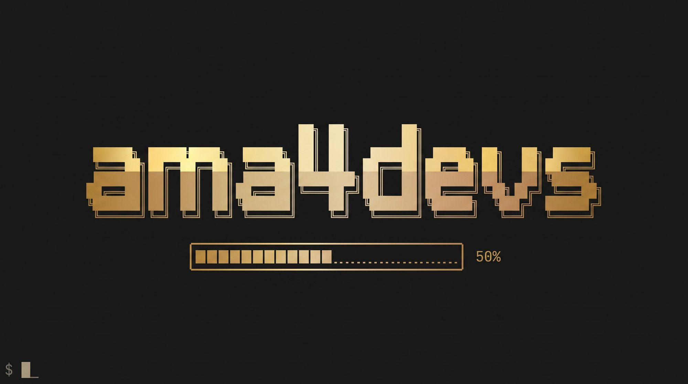

<p align="center"><b>English</b> · <a href="https://instituto-ama.github.io/ama4devs/portuguese/generator/">Português</a> · <a href="https://instituto-ama.github.io/ama4devs/generator/">Documentation site</a></p>

<p align="center"></p>

# Brazilian Fake Data Generator, Asaas Populator & Direct Data Credit Check

**Valid fake Brazilian data for tests, seeded fixtures, instant Asaas mock population, and a faithful Direct Data credit check.**

Generates valid documents (CPF, CNPJ, CNH, PIS, RG), realistic individuals and companies with addresses matching Brazilian CEP ranges and DDDs, credit cards, bank accounts, Pix keys, and billing charges. The core runs with zero dependencies in Node, Bun, or directly inside the browser. It also populates the [Asaas mock](https://instituto-ama.github.io/ama4devs/asaas/) with customers and charges in a single call, and answers the Direct Data API v3 credit routes at the provider's own paths ([Direct Data Credit Check](#direct-data-credit-check)).

<p align="center">
  <a href="https://github.com/Instituto-AMA/ama4devs/pkgs/container/generator-mock"></a>
  
  <a href="LICENSE"></a>
</p>

## Quick Start

### Docker

```bash
docker run --rm -p 45450:45450 ghcr.io/instituto-ama/generator-mock:latest
```

Open [http://localhost:45450](http://localhost:45450) in your browser to use the interactive generator UI, or call the API:

```bash
curl 'http://localhost:45450/v1/person?count=2&seed=demo'
```

### Docker Compose

In another project's compose, add a `generator` service next to `asaas`. Both find each other automatically by service name:

```yaml
  generator:
    image: ghcr.io/instituto-ama/generator-mock:0.3.0
    ports:
      - '45450:45450'
    depends_on:
      - asaas
```

When `ASAAS_URL` is unset, the generator discovers the Asaas mock on boot and every 10 s (`asaas`, `asaas-mock`, `localhost`, `host.docker.internal` on port 45445). So `docker run` of both, or both in any compose, needs no variable.

In this repository, running `make up` boots the generator along with the Asaas mock (port 45450). Setting `GENERATOR_ENABLED=0` in `.env` keeps it down (`deploy.replicas`).

## API Endpoints

The HTTP service listens on port `45450` by default. All `/v1/*` endpoints allow CORS (`Access-Control-Allow-Origin: *`). The `/api/*` Direct Data routes are the provider's own paths; they send the same CORS header, so the [playground](https://instituto-ama.github.io/ama4devs/generator/playground/?route=credit) on Pages can call your container. Online, with no container, every test CPF also has a static answer: `curl https://instituto-ama.github.io/ama4devs/generator/api/Score/11100000143` (also `BoaVistaAcertaMaisPositivoPF/<cpf>`; the list and the status each one answers in `generator/api/directd.json`).

| Method & Route | Description |
|---|---|
| `GET /health` | Healthcheck: `{ status: 'ok', service: 'generator', version }` |
| `GET /` | Built-in web UI (static assets served from `public/`) |
| `GET /core/<name>.js` | Raw browser-native ES module files (`src/core/<name>.js`) |
| `GET /v1/kinds` | List available kinds: `{ kinds: [{ id, label }] }` |
| `GET /v1/validate/:type/:value` | Validate a document: `{ type, value, valid }` for `cpf`, `cnpj`, `cnh`, `pis` |
| `GET /v1/:kind` | Generate items for any kind. Accepts query parameters: `count` (1–1000), `seed`, `formatted`, `state`, `gender`, `outcome`, `billingType`, `now` |
| `GET /_mock/asaas/status` | Asaas connection check: `{ asaasUrl, panelUrl, reachable, customers }` |
| `POST /_mock/asaas/populate` | Populate the Asaas mock with realistic customers and charges |
| `GET /api/Score` | Direct Data credit score of a CPF (the QUOD report) |
| `GET /api/BoaVistaAcertaMaisPositivoPF` | Direct Data Boa Vista report of a CPF ("Acerta Mais Positivo") |
| `GET /api/Historico/ObterRetornoConsultaAsync` | Direct Data async result, read by `ConsultaUid` |
| `GET /_mock/directd/test-cpfs` | The Direct Data test CPF table, the outcomes and the policy of the unlisted CPFs |
| `POST /_mock/directd/test-cpfs` | Adds or replaces a test CPF: `{ cpf, outcome, profile? }` |
| `DELETE /_mock/directd/test-cpfs/{cpf}` | Removes one test CPF |
| `DELETE /_mock/directd/test-cpfs` | Restores the default table and the policy of the environment |
| `PUT /_mock/directd/test-cpfs/policy` | Sets the policy of the unlisted CPFs: `{ unlisted }` |
| `POST /_mock/directd/queries/{uid}/release` | Releases an async consultation that would never settle |
| `GET /_mock/directd/requests` | The request log of the Direct Data routes (the token is kept as its state, never its value) |
| `GET /_mock/directd/state` | The counters of the charge rule, the async queries and the policy |
| `DELETE /_mock/directd/state` | Resets the request log, the async queries and the counters |

### Supported Kinds

1. `person` — Realistic individual with name, CPF, RG, CNH, PIS, birth date, mother's name, email, phone, and complete address.
2. `company` — Company with CNPJ, corporate name, trade name, state/municipal registration, opening date, CNAE activity, address, and partners.
3. `address` — Address matching Brazilian state, city, real postal code (CEP) range, and IBGE code.
4. `cpf` — Brazilian Individual Taxpayer Registry number with valid check digits.
5. `cnpj` — Brazilian National Registry of Legal Entities number with valid check digits.
6. `cnh` — Brazilian National Driver's License number with valid DENATRAN check digits.
7. `pis` — Brazilian Social Integration Program number with valid mod-11 check digits.
8. `rg` — General Registry identity document with check digit.
9. `credit-card` — Test credit card details (approved, declined, or random Luhn-valid).
10. `bank-account` — Bank account with real Brazilian bank code, agency, account number, and type.
11. `pix-key` — Pix keys of type `CPF`, `CNPJ`, `EMAIL`, `PHONE`, or `EVP` (random UUIDv4).
12. `charge` — Financial charge with billing type (`PIX`, `BOLETO`, `CREDIT_CARD`), value in BRL, due date, and description.

## Determinism

Every generator function relies on a deterministic pseudo-random number generator (mulberry32). Supplying the same `seed`, kind, options, and reference date (`now`) guarantees the exact same output across runs:

```bash
# Returns identical data every time:
curl 'http://localhost:45450/v1/person?seed=fixture-1&now=2026-10-29'
```

This ensures predictable, flake-free test fixtures for automated testing suites.

## Safe Data Guarantees

All synthetic data generated adheres to safety standards:
- **Email addresses:** Constrained to RFC 2606 reserved testing domains (`example.com`, `example.org`, `example.net`).
- **Website addresses:** Formatted as `https://www.slug.example.com`.
- **Phone numbers:** Mobile phones use valid regional DDDs with subscriber digits compliant with telecommunication rules (no repeated digits).
- **Test Cards:** Default `APPROVE` outcome uses `4444444444444444`; `DECLINE` uses `5184019740373151`.

## Asaas Mock Population

Populate the Asaas mock in a single HTTP call, or directly from the Asaas panel.

When both services run together, the Asaas mock discovers the generator automatically (probing `generator`, `generator-mock`, `localhost`, and the Docker host on port 45450 every 10 s). While connected, the Asaas panel (<http://localhost:45445>) displays an **Integrations › Generator** tab showing status, an "Open generator" action, and a "Populate this account" button that seeds the account selected in the topbar via `POST /_admin/generator/populate`. If the generator is unreachable or turned off, the tab does not exist.

You can also call the generator endpoint directly:

```bash
curl -X POST http://localhost:45450/_mock/asaas/populate \
  -H 'Content-Type: application/json' \
  -d '{
    "people": 5,
    "companies": 2,
    "chargesPerCustomer": 2,
    "billingTypes": ["PIX", "BOLETO", "CREDIT_CARD"],
    "confirm": 0.5,
    "seed": "demo",
    "apiKey": "$aact_hmlg_..."
  }'
```

### How it works
1. **Target Account:** Uses the `apiKey` from the request body if specified, otherwise falling back to `ASAAS_API_KEY`.
2. **Creates Customers:** Calls `POST /v3/customers` on the Asaas mock for each person and company generated.
3. **Creates Payments:** Calls `POST /v3/payments` for each customer according to `chargesPerCustomer` and `billingTypes`.
4. **Simulates Confirmations:** For a proportion of charges determined by `confirm` (0.0 to 1.0), calls `POST /v3/sandbox/payment/{id}/confirm` to simulate completed payments.
5. **Returns Summary:** Provides IDs, direct links to the Asaas simulator panel, and any errors encountered during execution.

### Automatic Seed on Boot

Set `ASAAS_SEED_ON_BOOT` (or `GENERATOR_ASAAS_SEED_ON_BOOT` in the root `.env`) to automatically populate Asaas when the container starts (stays off unless set):

```bash
ASAAS_SEED_ON_BOOT="people=10,companies=3,charges=2,confirm=0.5"
```

## Direct Data Credit Check

The generator also answers the **Direct Data API v3** credit routes the Hub uses, at the provider's own paths, faithful to the provider's documentation ([`spec/directd/`](spec/directd/README.md)). The generator never calls the provider: every answer is computed locally, and the only token it accepts is the public `00000000-0000-4000-8000-00000000d1d1` — no real token ever lives in this repository.

| Route | What it answers |
|---|---|
| `GET /api/Score` | The QUOD credit score of a CPF |
| `GET /api/BoaVistaAcertaMaisPositivoPF` | The Boa Vista "Acerta Mais Positivo" report of a CPF |
| `GET /api/Historico/ObterRetornoConsultaAsync` | The result of an async consultation, by `ConsultaUid` |
| `POST /api/Webhook/CreateUrlCallBack` | Registers the URL the provider posts the callbacks to |
| `POST /api/Webhook/ConfirmUrlCallBack` | Confirms the code the provider sent to that URL |
| `GET /api/Marketplace/GetBalance` | The balance of the account |
| `GET /api/Billing/GetConsumptionApiV3` | The consumption of the account |

The webhook and the account routes take the token in the `Token` header, the way the provider takes it there; the
credit routes take it in the query string.

Every parameter goes in the query string, the way the provider takes them:

| Parameter | What it is |
|---|---|
| `CPF` | The document, with or without the mask (`529.982.247-25` or `52998224725`) |
| `TOKEN` | The public token of the simulation |
| `Async` | `habilitar` asks for an asynchronous consultation (`201` with the `consultaUid`) |
| `Callback` | `habilitar` asks for a callback: the mock posts it to the URL of a confirmed registration (nothing is posted anywhere else) |
| `GERARCOMPROVANTE` | `Habilitar` only records the flag (`gerarComprovante: true`); no PDF is produced |

A call without the token (or with a wrong one) answers `401`. Every other answer carries the documented envelope, in the documented key order — a `200` of the Score route:

```json
{
  "metaDados": {
    "consultaNome": "Score de Crédito - QUOD",
    "consultaUid": "direct-6b1f0d1e-6a5e-4a6c-9a5a-6f5f0d1e6a5e",
    "chave": "CPF=11100000143;",
    "usuario": "usuario@ama4devs.local",
    "mensagem": "Sucesso",
    "ip": "127.0.0.1",
    "resultadoId": 1,
    "resultado": "Sucesso",
    "apiVersao": "v3",
    "enviarCallback": false,
    "gerarComprovante": false,
    "urlComprovante": null,
    "assincrono": false,
    "data": "31/10/2026 09:00:00",
    "tempoExecucaoMs": 3
  },
  "retorno": {
    "dataConsulta": "31/10/2026 09:00:00",
    "documentoConsultado": "111.000.001-43",
    "pessoaFisica": {
      "score": 850,
      "faixaScore": "801 a 900",
      "capacidadePagamento": "R$ 2.500,00",
      "perfil": "Bom pagador"
    },
    "pessoaJuridica": null,
    "observacao": null
  }
}
```

An asynchronous consultation answers `201`, with the `consultaUid` of the query and no `retorno` yet:

```json
{
  "metaDados": {
    "consultaNome": "Score de Crédito - QUOD",
    "consultaUid": "direct-6b1f0d1e-6a5e-4a6c-9a5a-6f5f0d1e6a5e",
    "chave": "CPF=11100000143;",
    "usuario": "usuario@ama4devs.local",
    "mensagem": "Requisição async criada com sucesso. Utilize o ConsultaUid para consultar o resultado.",
    "ip": "127.0.0.1",
    "resultadoId": 1,
    "resultado": "Sucesso",
    "apiVersao": "v3",
    "enviarCallback": false,
    "gerarComprovante": false,
    "urlComprovante": null,
    "assincrono": true,
    "data": "31/10/2026 09:00:00",
    "tempoExecucaoMs": 2
  },
  "retorno": null
}
```

The rate limit is the one answer that is not an envelope — it carries the `Retry-After: 30` header too:

```json
{
  "status": 429,
  "error": "Too Many Requests",
  "message": "Você realizou muitas requisições. Aguarde 30 segundos e tente novamente.",
  "retryAfterSeconds": 30
}
```

The statuses of the routes: `200` (the answer), `201` (async consultation created), `202` (async consultation still running), `400` (invalid or missing CPF), `401` (invalid or missing token), `403` (no balance), `404` (no record for the document), `408` (the provider did not answer in time), `429` (more than 30 requests per second), `500` (internal error) and `503` (the consultation is under maintenance).

### The webhook

The mock answers the provider's webhook routes ([`spec/directd/webhook.md`](spec/directd/webhook.md)): the URL is
registered, the provider posts a code to it and the receiver confirms that code. Then every consultation that
settles posts its callback to the confirmed URL.

The mock never leaves the machine: it posts only to a loopback host (`127.0.0.1`, `::1`, `localhost`) or to a
single-label host (a service of a compose network, like `hub-webhooks`). Any other URL is refused with `400` and
nothing is posted.

```bash
# Register the URL of the receiver (200). The mock posts the code to it.
curl -s -X POST 'http://localhost:45450/api/Webhook/CreateUrlCallBack' \
  -H 'Token: 00000000-0000-4000-8000-00000000d1d1' \
  -H 'content-type: application/json' \
  -d '{"Url":"http://localhost:45451/webhooks/directd"}'

# The registration: the URL, the code and whether it is confirmed.
curl -s 'http://localhost:45450/_mock/directd/webhook'

# Confirm the code the receiver got (200).
CODE=$(curl -s 'http://localhost:45450/_mock/directd/webhook' | grep -o '"code": "[^"]*"' | cut -d'"' -f4)
curl -s -X POST 'http://localhost:45450/api/Webhook/ConfirmUrlCallBack' \
  -H 'Token: 00000000-0000-4000-8000-00000000d1d1' \
  -H 'content-type: application/json' \
  -d "{\"Code\":\"$CODE\"}"
```

The code the provider sends is `CALL-` and four uppercase alphanumerics, and the mock keeps one registration: a
new `CreateUrlCallBack` replaces the previous one. A receiver that does not answer `201` leaves the registration
unconfirmed, and an unconfirmed URL receives no callback.

The callback of a consultation carries the documented keys, in this order — `Product`, `Id`, `Status` and `Url`:

```json
{
  "Product": "APIv3",
  "Id": "direct-6b1f0d1e-6a5e-4a6c-9a5a-6f5f0d1e6a5e",
  "Status": "Finished",
  "Url": "http://localhost:45450/api/Historico/ObterRetornoConsultaAsync?ConsultaUid=direct-6b1f0d1e-6a5e-4a6c-9a5a-6f5f0d1e6a5e"
}
```

`Status` is `Finished` when the consultation succeeded and `Error` when it failed. The control routes drive the
webhook from a script:

| Route | What it does |
|---|---|
| `GET /_mock/directd/webhook` | The registration: `{ url, confirmed, code }` |
| `POST /_mock/directd/webhook/fire` | Posts a callback now: `{ "product": "APIv3", "id": "…", "status": "Modified" }`; `409` when nothing is confirmed |
| `DELETE /_mock/directd/webhook` | Clears the registration |

### The balance and the consumption

The mock keeps a balance — it starts at `DIRECTD_BALANCE` (500 by default) and every consultation the provider
charges subtracts the cost of its product (`Score` 1.98, `BoaVistaAcertaMaisPositivoPF` 11.18). A balance shorter
than the cost answers the `403` of the `Saldo insuficiente` outcome, and nothing is charged.

```bash
# The balance of the account (200).
curl -s 'http://localhost:45450/api/Marketplace/GetBalance' \
  -H 'Token: 00000000-0000-4000-8000-00000000d1d1'

# The consumption of the account (200).
curl -s 'http://localhost:45450/api/Billing/GetConsumptionApiV3' \
  -H 'Token: 00000000-0000-4000-8000-00000000d1d1'
```

The answer of the balance, in the key order of the real one:

```json
{
  "balance": {
    "description": "Faturamento Saldo (Pré)",
    "type": "Prepaid",
    "balance": 500,
    "addedLast30Days": 0,
    "consumedLast30Days": 0
  },
  "success": true,
  "status": "OK",
  "elapsedTimeMs": 1,
  "dateTimeExecution": "11/4/2026 3:36:08 PM",
  "error": null
}
```

The control routes drive the balance from a script:

| Route | What it does |
|---|---|
| `GET /_mock/directd/balance` | The balance, the same body the provider route answers |
| `POST /_mock/directd/balance` | Sets the balance (`{ "set": 12.5 }`) or tops it up (`{ "add": 100 }`); a top-up joins `addedLast30Days` |

### The test CPFs

Each CPF below is known by the mock and forces one outcome, the way the Asaas test cards force theirs:

| CPF | Outcome | Status | What it answers |
|---|---|---|---|
| `11100000143` | `lowRisk` | 200 | 200, score 850, 3,5% default probability |
| `11100111212` | `mediumRisk` | 200 | 200, score 650, 18% default probability |
| `11100222391` | `highRisk` | 200 | 200, score 420, 41% default probability |
| `11100333460` | `restrictions` | 200 | 200, score 380, debts, protests and restrictions |
| `11100444530` | `deceased` | 200 | 200, score 0, deceased person |
| `11100555609` | `irregular` | 200 | 200, score 500, suspended CPF |
| `11101666641` | `warnings` | 200 | 200 with warnings, score 700 |
| `11111111112` | `badDocument` | 400 | 400, invalid CPF digits |
| `11100666788` | `notFound` | 404 | 404, no record for the document |
| `11100777857` | `timeout` | 408 | 408, the provider did not answer in time |
| `11100888926` | `noBalance` | 403 | 403, insufficient balance |
| `11101000007` | `unauthorized` | 401 | 401, invalid IP or token |
| `11101111186` | `rateLimited` | 429 | 429, more than 30 requests per second |
| `11101222255` | `unavailable` | 503 | 503, consultation under maintenance |
| `11101333324` | `internalError` | 500 | 500, internal error |
| `11101444401` | `slow` | 200 | 200, after a 25 s wait |
| `11101555572` | `neverSettles` | 200 | 200, the async read stays 202 |

### Configuring them

Like the Asaas test cards, the table is data: the Direct Data sheet of the panel edits it, and the control routes do it from a script.

| Route | What it does |
|---|---|
| `GET /_mock/directd/test-cpfs` | The table, the outcomes and the policy of the unlisted CPFs |
| `POST /_mock/directd/test-cpfs` | Adds or replaces a row: `{ "cpf": "…", "outcome": "highRisk", "profile": { … } }` |
| `DELETE /_mock/directd/test-cpfs/{cpf}` | Removes one row |
| `DELETE /_mock/directd/test-cpfs` | Restores the default table and the policy of the environment |
| `PUT /_mock/directd/test-cpfs/policy` | Sets the policy of the unlisted CPFs: `{ "unlisted": "derived" }` |

A valid CPF outside the table follows one of three policies:

| Policy | What it answers |
|---|---|
| `lowRisk` | The low risk preset (the default, and the value of `DIRECTD_UNLISTED`) |
| `derived` | A profile drawn from the CPF itself with the seeded rng: the same CPF always draws the same person |
| `notFound` | `404`, as if the document were unknown |

### Async consultations

`Async=habilitar` creates the consultation in the background and answers `201` with its `consultaUid`; the result is read afterwards, `202` while the consultation runs and `200` with the full envelope when it is over:

```bash
# The consultation is created in the background (201) and its id is kept.
CONSULTA_UID=$(curl -s 'http://localhost:45450/api/Score?CPF=11100000143&TOKEN=00000000-0000-4000-8000-00000000d1d1&Async=habilitar' \
  | grep -o '"consultaUid": "[^"]*"' | head -1 | cut -d'"' -f4)

# The first read answers 202 (still running), the next one the full envelope (200).
curl -s "http://localhost:45450/api/Historico/ObterRetornoConsultaAsync?ConsultaUid=$CONSULTA_UID&TOKEN=00000000-0000-4000-8000-00000000d1d1"
```

The CPF `11101555572` never settles on its own: its read stays `202` until the query is released with `POST /_mock/directd/queries/{uid}/release`.

### The request log and the counters

Every call to the provider's routes is logged, and the token is kept as its state (`valid`, `invalid` or `missing`), never as its value.

| Route | What it answers |
|---|---|
| `GET /_mock/directd/requests` | The log of the calls, newest first (the last 500) |
| `GET /_mock/directd/state` | The counters, the async queries and the policy |
| `DELETE /_mock/directd/state` | Resets the log, the async queries and the counters |

The provider charges a consultation whose result is `Sucesso` or `Sucesso com Ressalvas`, and the mock counts exactly that: the `charged` counter grows once per `consultaUid`, when the consultation answers `200`. Every other answer is counted as not charged.

### Using it from an application

The application points at the generator by its URL — in this repository's compose, the service name:

```bash
DIRECTD_MOCK_URL=http://generator:45450
```

Outside compose, with the container published on the host:

```bash
DIRECTD_MOCK_URL=http://localhost:45450
```

### The calls

```bash
# The score of a test CPF (200).
curl 'http://localhost:45450/api/Score?CPF=11100000143&TOKEN=00000000-0000-4000-8000-00000000d1d1'

# The same CPF with its mask (200).
curl 'http://localhost:45450/api/Score?CPF=111.000.001-43&TOKEN=00000000-0000-4000-8000-00000000d1d1'

# The Boa Vista report of the same CPF (200).
curl 'http://localhost:45450/api/BoaVistaAcertaMaisPositivoPF?CPF=11100000143&TOKEN=00000000-0000-4000-8000-00000000d1d1'

# A failure: the CPF with the invalid check digits (400).
curl 'http://localhost:45450/api/Score?CPF=11111111112&TOKEN=00000000-0000-4000-8000-00000000d1d1'

# A call without the token (401).
curl 'http://localhost:45450/api/Score?CPF=11100000143'
```

### What is not simulated

- The `resultadoId` and `resultado` of `202`, `400`, `403`, `404`, `408`, `500`, `503` and of `Sucesso com Ressalvas` are the simulator's own choice: the provider documents only `1 Sucesso` and `3 Não Autorizado`.
- `consultaUid` and `chave` are `null` when the call is refused before a consultation exists (`400`, `401`, `403`), and set when the consultation itself failed (`404`, `408`, `500`, `503`).
- The texts of `faixaScore`, `perfil`, `capacidadePagamento`, `rendaPresumida.faixa` and every other descriptive field are plausible values, documented per scenario above.
- `Callback=habilitar` asks for a callback: the mock posts it to the URL of a confirmed registration, and to
  nowhere else.
- `GERARCOMPROVANTE=Habilitar` only records the flag: no PDF is produced and `urlComprovante` stays `null`.
- `GET /api/Historico?ConsultaUid=` (the `{ info, retorno }` form) is not simulated.
- The 429 is forced by its test CPF only: the mock counts no requests per second, and `retryAfterSeconds` is always `30` (no progressive block).
- `Async=habilitar` on a CPF that fails answers the failure at once, with no `201`; the slow CPF waits only on a synchronous call — its async consultation is created at once.
- The async read answers `202` on the first read and the final envelope from the second on (or at once after a release); an unknown `ConsultaUid` answers `404` named `Obter Retorno Consulta Async`.
- The parameter names are read whatever their case (`cpf`, `async`, `token`).

## Environment Variables

| Variable | Default | Description |
|---|---|---|
| `PORT` | `45450` | Port the server listens on |
| `GENERATOR_ENABLED` | `1` | In Compose, controls service replicas (`deploy.replicas`). Set `0` to keep down |
| `ASAAS_URL` | *(unset: found by itself)* | Base URL of the Asaas mock API. When unset, discovered automatically |
| `ASAAS_API_KEY` | `$aact_hmlg_local_master` | Default API key for customer and charge creation (overridable via `apiKey` in populate body) |
| `ASAAS_PANEL_URL` | `http://localhost:45445` | Browser-accessible URL for Asaas panel links |
| `ASAAS_SEED_ON_BOOT` | `""` | Comma-separated boot seed configuration (stays off unless set) |
| `DIRECTD_UNLISTED` | `lowRisk` | What the Direct Data credit check answers for a valid CPF outside the test table: `lowRisk`, `derived` or `notFound` |
| `DIRECTD_BALANCE` | `500.00` | The balance the Direct Data mock starts with |
| `WEBHOOK_LOCALHOST_REWRITE` | empty | The host a webhook registered on `localhost`/`127.0.0.1` is delivered to (`host.docker.internal` when the Hub runs on the Docker host); the registration keeps the address the Hub sent |
| `MOCK_ALLOWED_HOSTS` | `""` | Comma-separated list of additional host headers allowed by the local guard |

## Local Guard

To ensure safe local development, the root endpoint (`/`) and internal management routes (`/_mock/*`) enforce a Host and Origin guard. Requests from standard local origins (`localhost`, `127.0.0.1`, `::1`, `host.docker.internal`) are accepted. Additional allowed hosts can be configured via `MOCK_ALLOWED_HOSTS`.

## Testing

Run unit and integration tests with Bun:

```bash
bun test
```

From the repository root:

```bash
make test
```

## Documentation

Full documentation, usage examples, and browser-based generator are available at:
[https://instituto-ama.github.io/ama4devs/generator/](https://instituto-ama.github.io/ama4devs/generator/)
