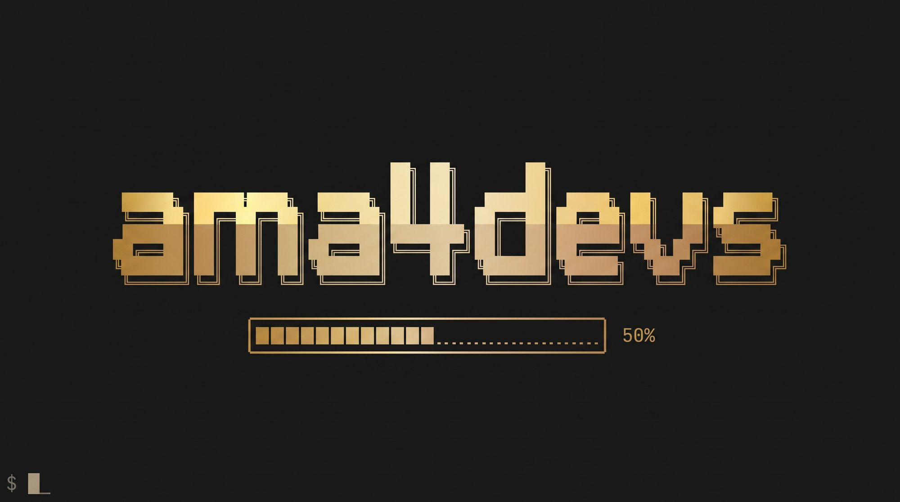

<p align="center"><b>English</b> · <a href="https://instituto-ama.github.io/ama4devs/portuguese/llm/">Português</a> · <a href="https://instituto-ama.github.io/ama4devs/llm/">Documentation site</a></p>

<p align="center"></p>

# LLM Mock Server

**An OpenAI-compatible chat-completions stub that stands in for the Vercel AI Gateway (`/v1`) and OpenRouter (`/api/v1`).** Deterministic and completely self-contained: no real model or external provider is ever called. Designed for fast local development and automated testing with realistic message completions, tool calling simulation, streaming Server-Sent Events (SSE), token usage estimation, exact catalog pricing, latency injection, scripted rule matching, and an in-memory control and request inspection API.

<p align="center">
  <a href="https://github.com/Instituto-AMA/ama4devs/pkgs/container/llm-mock"></a>
  
  <a href="LICENSE"></a>
</p>

## Quick Start

Run the container:

```bash
docker run --rm -p 45470:45470 ghcr.io/instituto-ama/llm-mock:latest
```

Or start it from the repository root:

```bash
make up MOCKS=llm
```

Send a completion request using `curl`:

```bash
curl -s -X POST http://localhost:45470/v1/chat/completions \
  -H 'Content-Type: application/json' \
  -H 'Authorization: Bearer any-key' \
  -d '{
    "model": "deepseek/deepseek-v4.1-flash",
    "messages": [
      { "role": "user", "content": "Qual o faturamento deste mês?" }
    ]
  }'
```

To point the official OpenAI SDK at the mock, configure the client's `base_url`:

```javascript
import OpenAI from 'openai';

const client = new OpenAI({
  apiKey: 'any-key',
  baseURL: 'http://localhost:45470/v1',
});

const completion = await client.chat.completions.create({
  model: 'deepseek/deepseek-v4.1-flash',
  messages: [{ role: 'user', content: 'Qual o faturamento deste mês?' }],
});

console.log(completion.choices[0].message.content);
```

## Endpoints

The mock exposes the following provider routes and control endpoints:

| Method & Route | Description |
|---|---|
| `GET /health` | Health check (`{ status: 'ok', service: 'llm-mock', version }`), unguarded. |
| `GET /v1/models` | List models in Vercel AI Gateway shape (`{ object: 'list', data: [...] }`). |
| `GET /models` | Alias for `GET /v1/models`. |
| `GET /api/v1/models` | List models in OpenRouter shape (`{ data: [...] }`). |
| `GET /v1/models/:id` | Fetch details of a single model by ID (ID may contain `/`). |
| `POST /v1/chat/completions` | Create chat completion (Vercel gateway format). |
| `POST /chat/completions` | Alias for `POST /v1/chat/completions`. |
| `POST /api/v1/chat/completions` | Create chat completion (OpenRouter gateway format). |
| `GET /_mock/llm/state` | Inspect current engine state: settings, rules, catalog, request count, version, boot errors. |
| `GET /_mock/llm/settings` | Read runtime settings. |
| `PUT /_mock/llm/settings` | Patch runtime settings. Returns `200` with updated settings or `400` with errors. |
| `GET /_mock/llm/rules` | List all active scripted rules. |
| `POST /_mock/llm/rules?position=first\|last` | Add one or more scripted rules (`position` defaults to `last`). Returns `201` or `400`. |
| `DELETE /_mock/llm/rules/:id` | Remove a single rule by ID (`204 No Content` or `404 Not Found`). |
| `DELETE /_mock/llm/rules` | Remove all rules (`204 No Content`). |
| `GET /_mock/llm/catalog` | Get current models catalog. |
| `PUT /_mock/llm/catalog` | Replace entire catalog (`200 OK` or `400 Bad Request`). |
| `POST /_mock/llm/catalog` | Upsert a single model in the catalog (`200 OK` or `400 Bad Request`). |
| `DELETE /_mock/llm/catalog/:id` | Remove a model from the catalog (ID may contain `/`). |
| `GET /_mock/llm/requests?limit=50` | List logged requests, newest first (up to `limit`, max 1000). |
| `GET /_mock/llm/requests/:id` | Fetch a single logged request by ID. |
| `DELETE /_mock/llm/requests` | Clear all logged requests (`204 No Content`). |
| `POST /_mock/llm/reset` | Reset settings, rules, and catalog back to boot state, and clear request log. |

## How It Answers

When a chat completion request arrives, the mock evaluates it in the following strict order of checks:

1. **Body Validation:** Request must be a JSON object containing a string `model` and a non-empty array `messages`. Bodies exceeding 4 MiB are rejected with `413 Payload Too Large`. Invalid schemas return `400 Bad Request` with `errorBody(400, 'invalid request: <why>', 'invalid_request_error')`.
2. **Authentication:** Checks the `Authorization: Bearer <token>` header. If the token is missing or empty and `requireAuth` is enabled (`true`), returns `401 Unauthorized` (`invalid_api_key`). Magic keys always apply regardless of `requireAuth`.
3. **Model Verification:** Checks if the requested model exists in the catalog. If unknown and `unknownModels === 'reject'`, returns `404 Not Found` (`model_not_found`).
4. **Scripted Rules & Decision:** Evaluates scripted rules in order. The first rule whose `match` criteria hold answers. If no rule matches, the built-in `auto` reply heuristic decides the outcome. The matched rule is consumed (`times` decremented).
5. **Latency Delay:** Awaits the computed latency (`settings.latencyMs` + rule latency + marker latency).
6. **Reply Execution:**
   - If the reply is an `error`, responds with the specified HTTP status code and error payload (status `429` attaches `Retry-After: 1`).
   - If `stream: true`, streams SSE chunks (`text/event-stream`) with chunk delays.
   - Otherwise, returns a standard JSON completion body (`completionBody`).
7. **Request Logging:** Logs request metadata and decision details (omitting any authorization headers).

### The Auto Reply Step-by-Step

When no scripted rule matches (or a rule specifies `reply: { kind: 'auto' }`), the engine resolves the reply using these steps:

1. **Error Marker:** If the last user message contains `[mock:error=STATUS]`, returns an error reply with that status code (`kind: 'error'`).
2. **Echo Marker:** If `[mock:echo]` is present, echoes back the stripped question as text (`kind: 'text'`).
3. **Forced Text:** If `[mock:text]` is present, or no tools are offered in `req.tools`, or `settings.toolStrategy === 'none'`, generates a text answer (step 6).
4. **Forced Tool Marker:** If `[mock:tool=NAME]` is specified, the named tool is offered, and `toolRounds < settings.maxToolRounds`, generates a tool call for it. Otherwise falls back to a text answer.
5. **Tool Strategy Selection:** If `toolRounds < settings.maxToolRounds`, picks an uncalled tool using the configured `toolStrategy` (`match`, `first`, or `none`). If a tool is picked, generates dummy arguments based on its JSON Schema parameters and returns `kind: 'tool_calls'`. If no tool is picked, proceeds to text answer.
6. **Text Answer Generation:** Renders the configured `answerTemplate` with filled placeholders.

### Tool Choice Strategies

The `toolStrategy` setting controls how tools are selected:
- `none`: Never calls any tool automatically.
- `first`: Picks the first tool in `req.tools` that has not yet been called in the current round.
- `match`: Scores candidate tools against the question:
  - Normalizes the question (lowercase, removes accents, splits into tokens with length ≥ 3).
  - Tokens appearing in the tool name (split by `_`, `.`, `-`) add 2 points each.
  - Tokens appearing as substrings in the tool description add 1 point each.
  - The highest score > 0 wins (ties keep the first). A score of 0 triggers no tool call.

### Generated Arguments

When the engine generates arguments for a tool call (`argumentsFor`), it inspects the tool's JSON schema `required` fields and generates deterministic values:
- `default`: Uses the schema default if defined.
- `enum`: Uses `enum[0]`.
- `examples`: Uses `examples[0]`.
- By `type`:
  - `string`: If `format === 'date'`, returns current ISO date (`YYYY-MM-DD`). If `format === 'date-time'`, returns `${today}T00:00:00Z`. Otherwise `""`.
  - `integer` / `number`: Returns `minimum ?? 1`.
  - `boolean`: Returns `false`.
  - `array`: If `minItems > 0`, returns a single-item array with the item schema's value; otherwise `[]`.
  - `object`: Recursively generates arguments for the nested schema.
  - `null`: Returns `null`.
  - Unknown: Returns `""`.

### Max Tool Rounds

The `maxToolRounds` setting (default `1`) caps how many consecutive assistant tool-call rounds can occur after the last user message. Once `toolRounds(messages) >= maxToolRounds`, the auto engine refuses further tool calls and produces the final text response.

### Answer Template and Placeholders

The default template (`DEFAULT_ANSWER_TEMPLATE`) is:

```text
Resposta simulada pelo mock de LLM para: "{question}". Ferramentas consultadas: {tools}. Resultados recebidos: {results}.
```

Placeholders:
- `{question}`: The cleaned text of the last user message (markers stripped and trimmed).
- `{tools}`: Comma-separated names of tools called after the last user message, or `nenhuma`.
- `{results}`: Count of `role: 'tool'` messages received after the last user message.

## Markers and Magic Keys

### Markers

Markers are special tokens placed directly in the user prompt to control the mock dynamically without changing settings or rules:

| Marker | Description |
|---|---|
| `[mock:error=STATUS]` | Injects an HTTP error response with status `STATUS` (integer 400–599, e.g. `[mock:error=429]`). |
| `[mock:text]` | Forces an immediate text response, bypassing tool calls even if tools are offered. |
| `[mock:tool=NAME]` | Forces a call to the specified tool name (if offered and rounds allow). |
| `[mock:latency=MS]` | Injects extra delay in milliseconds (integer 0–120000, e.g. `[mock:latency=1500]`). |
| `[mock:echo]` | Echoes back the stripped question text directly. |

Markers are case-insensitive (`[MOCK:...]` is accepted) and are stripped from `{question}` before formatting the response.

### Magic Keys

When sent in the `Authorization: Bearer <token>` header, magic keys trigger deterministic failure modes:

| Magic Key | HTTP Status | Error Code | Description |
|---|---|---|---|
| `mock-invalid-key` | `401` | `invalid_api_key` | Simulates an invalid or revoked API token. |
| `mock-no-credit` | `402` | `insufficient_credits` | Simulates an account with insufficient balance/credits. |
| `mock-rate-limited` | `429` | `rate_limit_exceeded` | Simulates rate limiting; attaches `Retry-After: 1` header. |
| `mock-down` | `503` | `service_unavailable` | Simulates upstream gateway outage. |

## Scripted Rules

Scripted rules allow deterministic matching and custom mocking of tool calls, errors, texts, or latency.

### Rule Fields

- `id`: Optional unique string identifier (assigned automatically as `rule_<n>` if omitted).
- `match`: Matching criteria (all specified fields must hold):
  - `model`: Exact model ID string.
  - `gateway`: `'vercel'` or `'openrouter'`.
  - `lastUser`: Case-insensitive regex string tested against the last user message text.
  - `system`: Case-insensitive regex string tested against the combined `system` and `developer` messages.
  - `hasTools`: Boolean; whether tools are provided in `req.tools`.
  - `afterTool`: Boolean; whether the last message in the thread has `role: 'tool'`.
  - `toolOffered`: Exact tool name that must be present in `req.tools`.
  - `lastToolName`: Exact name of the tool whose result is the last message of the request: the tool call whose id is the `tool_call_id` of that message. It is what tells a rule which tool has just answered.
- `reply`: What the rule returns:
  - `{ kind: 'text', text: string }`
  - `{ kind: 'tool_calls', calls: [{ name: string, arguments: object }], text?: string }`
  - `{ kind: 'error', status: number, message: string, code?: string }`
  - `{ kind: 'auto' }`
- `latencyMs`: Optional additional delay in milliseconds (0–120000).
- `times`: Optional execution count limit. The rule is decremented on each match and removed when it reaches 0.
- `usage`: Optional usage override (`inputTokens`, `outputTokens`, `costUsd`).

### Rule Examples

#### 1. Force a tool call when the question mentions "faturamento" (once)

```bash
curl -X POST 'http://localhost:45470/_mock/llm/rules?position=first' \
  -H 'Content-Type: application/json' \
  -d '{
    "match": { "lastUser": "faturamento" },
    "reply": {
      "kind": "tool_calls",
      "calls": [
        {
          "name": "query_metrics",
          "arguments": { "metric": "revenue", "period": "current_month" }
        }
      ]
    },
    "times": 1
  }'
```

#### 2. Return HTTP 429 for a specific model

```bash
curl -X POST 'http://localhost:45470/_mock/llm/rules' \
  -H 'Content-Type: application/json' \
  -d '{
    "match": { "model": "deepseek/deepseek-v4.1" },
    "reply": {
      "kind": "error",
      "status": 429,
      "message": "Rate limit exceeded for deepseek-v4.1",
      "code": "rate_limit_exceeded"
    }
  }'
```

#### 3. Return fixed text after receiving a tool result

```bash
curl -X POST 'http://localhost:45470/_mock/llm/rules' \
  -H 'Content-Type: application/json' \
  -d '{
    "match": { "afterTool": true },
    "reply": {
      "kind": "text",
      "text": "Os dados foram processados com sucesso pelo mock."
    }
  }'
```

### Templates

The arguments of a tool call and the text of an answer accept placeholders. They are filled with what the request carries:

| Placeholder | Value |
|---|---|
| `{{question}}` | The text of the last user message, without the markers. |
| `{{today}}` | The day of the answer, as `YYYY-MM-DD`. |
| `{{date:+N}}` / `{{date:-N}}` | The day of the answer moved by `N` days, as `YYYY-MM-DD`. |
| `{{tool.<path>}}` | A value of the result of the last tool, `path` being dot-separated keys or array indexes (`{{tool.dataset_id}}`, `{{tool.columns.1.key}}`). |

A string that is one placeholder and nothing else keeps the type of its value (a number stays a number); a placeholder inside a longer string becomes its text. A placeholder the mock cannot resolve is empty. It never fails.

The rules below script a whole agent loop: the user asks, the mock calls the tool of the data, the result comes back with a `dataset_id` and the mock calls the render tool with that id, then answers with the text.

```json
[
  {"match":{"lastUser":"faturamos","afterTool":false},"reply":{"kind":"tool_calls","calls":[{"name":"read_data","arguments":{"source":"billing_report","params":{"from":"{{date:-30}}","to":"{{date:+1}}"}}}]}},
  {"match":{"lastToolName":"read_data"},"reply":{"kind":"tool_calls","calls":[{"name":"show_kpis","arguments":{"dataset_id":"{{tool.dataset_id}}","items":[{"label":"Faturamento","column":"{{tool.columns.1.key}}","aggregate":"sum"}]}}]}},
  {"match":{"lastToolName":"show_kpis"},"reply":{"kind":"text","text":"Aqui está o faturamento dos últimos 30 dias."}}
]
```

Post them in one call:

```bash
curl -X POST 'http://localhost:45470/_mock/llm/rules' \
  -H 'Content-Type: application/json' \
  -d '[
    {"match":{"lastUser":"faturamos","afterTool":false},"reply":{"kind":"tool_calls","calls":[{"name":"read_data","arguments":{"source":"billing_report","params":{"from":"{{date:-30}}","to":"{{date:+1}}"}}}]}},
    {"match":{"lastToolName":"read_data"},"reply":{"kind":"tool_calls","calls":[{"name":"show_kpis","arguments":{"dataset_id":"{{tool.dataset_id}}","items":[{"label":"Faturamento","column":"{{tool.columns.1.key}}","aggregate":"sum"}]}}]}},
    {"match":{"lastToolName":"show_kpis"},"reply":{"kind":"text","text":"Aqui está o faturamento dos últimos 30 dias."}}
  ]'
```

The second request of the loop carries the result of the first call:

```json
{"role":"tool","tool_call_id":"call_0","content":"{\"dataset_id\":\"ds-1\",\"columns\":[{\"key\":\"issued\"},{\"key\":\"billed\"}]}"}
```

and the mock answers with the call that renders the dataset of that result.

## Models Catalog

### Default Models

The server boots with a default catalog:

| ID | Name | Context Window | Max Output | Input Price ($/token) | Output Price ($/token) | Tools |
|---|---|---|---|---|---|---|
| `deepseek/deepseek-v4.1-flash` | DeepSeek V4.1 Flash | 128,000 | 8,192 | `0.00000027` | `0.0000011` | Yes |
| `deepseek/deepseek-v4.1` | DeepSeek V4.1 | 128,000 | 8,192 | `0.00000056` | `0.0000022` | Yes |
| `google/gemini-3.8-flash` | Gemini 3.8 Flash | 1,000,000 | 65,536 | `0.0000003` | `0.0000025` | Yes |
| `openai/gpt-6.1-mini` | GPT-6.1 mini | 400,000 | 32,768 | `0.00000025` | `0.000002` | Yes |
| `mock/text-only` | Mock text only | 32,000 | 4,096 | `0.0000001` | `0.0000004` | No |

### Answer Shapes

The catalog is formatted according to the gateway endpoint called:
- **Vercel AI Gateway (`GET /v1/models`):** Returns `{ object: 'list', data: [...] }`. Each item includes `id`, `object: 'model'`, `created: 0`, `owned_by: <id before '/'>`, `name`, `description: ''`, `context_window`, `max_tokens`, `type: 'language'`, `tags: ['tool-use']` (when tools are supported), and `pricing: { input, output }`.
- **OpenRouter (`GET /api/v1/models`):** Returns `{ data: [...] }`. Each item includes `id`, `name`, `created: 0`, `description: ''`, `context_length`, `pricing: { prompt, completion, request: '0', image: '0' }`, `top_provider: { context_length, max_completion_tokens, is_moderated: false }`, `supported_parameters: ['tools', 'tool_choice', ...]`, and `architecture: { modality: 'text->text', ... }`.

### Managing Catalog Models

- **Upsert model:** `POST /_mock/llm/catalog` with a single model object.
- **Replace catalog:** `PUT /_mock/llm/catalog` with an array of model objects.
- **Delete model:** `DELETE /_mock/llm/catalog/:id` (handles encoded or raw slashes in the model ID).

## Usage and Cost

### Token Estimation

Tokens are estimated deterministically using character counts:
- `estimateTokens(text)` = `Math.max(1, Math.ceil(text.length / 4))` (empty string yields `0`).
- **Prompt Tokens:** Sum of tokens across all message texts, plus stringified `req.tools` if tools are present.
- **Completion Tokens:** Tokens of the returned text, plus tool call names and stringified arguments. Error replies report 0 completion tokens.

### Cost Calculation & Gateway Placement

Cost is calculated with exact `BigInt` arithmetic in pico-dollars ($10^{-12}$) to prevent floating-point inaccuracies:

$$\text{cost} = (\text{promptTokens} \times \text{inputPrice}) + (\text{completionTokens} \times \text{outputPrice})$$

When `reportCost` is enabled (`true`), the cost is placed according to the gateway:
- **OpenRouter (`/api/v1`):** Placed in `usage.cost` as a numeric value (`Number(costUsd)`).
- **Vercel AI Gateway (`/v1`):** Placed in top-level `provider_metadata.gateway.cost` as a string (`costUsd`).

If `reportCost` is disabled (`false`), or the model is not found in the catalog, or the reply is an error, no cost is reported.

A request with `max_tokens` (or `max_completion_tokens`) cuts the reply's text at four characters per token, once, before the usage is computed: the non-streamed body and the streamed chunks carry the same cut text, finish with `length`, and `completion_tokens` and the cost count only what was sent.

## Streaming

When `stream: true` is requested, the mock emits Server-Sent Events (`text/event-stream`):
1. **Initial Chunk:** `delta: { role: 'assistant', content: '' }`.
2. **Content Chunks:** Emits response text in chunks of `streamChunkChars` characters, waiting `streamChunkDelayMs` between chunks.
3. **Tool Call Chunks:** If tools are called, each tool call is emitted as its own chunk in `delta.tool_calls`.
4. **Finish Chunk:** An empty `delta: {}` chunk with `finish_reason: 'stop'`, `'tool_calls'`, or `'length'`.
5. **Usage Chunk:** If `req.stream_options?.include_usage` is true or gateway is `openrouter`, an additional chunk with `choices: []` and the populated `usage` object (including cost) is emitted.
6. **Termination:** Concludes with `data: [DONE]\n\n`.

## Configuration

### Environment Variables

| Variable | Default | Description |
|---|---|---|
| `PORT` | `45470` | HTTP port the mock server listens on. |
| `LLM_LATENCY_MS` | `0` | Base latency in milliseconds added to every completion response. |
| `LLM_STREAM_CHUNK_DELAY_MS` | `15` | Delay in milliseconds between streamed SSE chunks. |
| `LLM_STREAM_CHUNK_CHARS` | `24` | Character size of text slices in stream chunks. |
| `LLM_REQUIRE_AUTH` | `1` | Enforce presence of non-empty `Authorization: Bearer <token>` header (`0` disables). |
| `LLM_UNKNOWN_MODELS` | `accept` | Policy for models not in catalog: `accept` or `reject` (returns 404). |
| `LLM_TOOL_STRATEGY` | `match` | Strategy for picking tools automatically: `match`, `first`, or `none`. |
| `LLM_MAX_TOOL_ROUNDS` | `1` | Maximum consecutive tool call rounds before generating text. |
| `LLM_ANSWER_TEMPLATE` | *(default)* | Answer template string with `{question}`, `{tools}`, `{results}`. |
| `LLM_REPORT_COST` | `1` | Include cost in usage metadata (`0` disables). |
| `LLM_MAX_REQUESTS` | `1000` | Maximum logged requests retained in memory. |
| `LLM_LOG_BODIES` | `0` | Store full request bodies in the request log (`1` enables). |
| `MOCK_ALLOWED_HOSTS` | `""` | Comma-separated extra allowed `Host` headers for the local guard. |
| `LLM_CONFIG_FILE` | `""` | Path to JSON file containing boot settings, rules, and catalog. |
| `LLM_CONFIG_JSON` | `""` | Inline JSON string containing boot settings, rules, and catalog. |

### Boot File Configuration

You can pre-configure the mock on startup using `LLM_CONFIG_FILE` or `LLM_CONFIG_JSON`:

```json
{
  "settings": {
    "latencyMs": 50,
    "toolStrategy": "match",
    "maxToolRounds": 2
  },
  "rules": [
    {
      "match": { "lastUser": "ajuda" },
      "reply": { "kind": "text", "text": "Como posso ajudar você hoje?" }
    }
  ],
  "catalog": [
    {
      "id": "custom/fast-model",
      "name": "Custom Fast Model",
      "contextWindow": 64000,
      "maxOutputTokens": 4096,
      "inputPrice": "0.0000001",
      "outputPrice": "0.0000005",
      "tools": true
    }
  ]
}
```

If a configuration file fails to parse or fails validation, errors are logged to `bootErrors` (visible in `GET /_mock/llm/state`); the server logs the issues and starts with default configuration without crashing.

## Request Log and Reset

- **View Recent Requests:** `GET /_mock/llm/requests?limit=50` lists requests in reverse chronological order (newest first). Sensitive authorization headers are never logged.
- **Inspect Single Request:** `GET /_mock/llm/requests/:id`.
- **Clear Log:** `DELETE /_mock/llm/requests`.
- **Reset Everything:** `POST /_mock/llm/reset` restores all settings, rules, and the models catalog to their initial boot values, and clears all request logs.

## The Local Guard

To ensure safe local development, all control routes (`/_mock/llm/*`), the root dashboard (`/`), and static assets enforce host validation. Requests must present an allowed `Host` header (`localhost`, `127.0.0.1`, `::1`, `host.docker.internal`, `llm`, `llm-mock`, or any listed in `MOCK_ALLOWED_HOSTS`). State-changing requests (`POST`, `PUT`, `DELETE`) also verify that the `Origin` header matches or is absent, refusing cross-site requests. The API routes (`/v1`, `/api/v1`, `/models`, `/chat/completions`) remain accessible to containers calling the service directly.

## Tests

Run the test suite with Bun:

```bash
bun test
```

## License

MIT License. See [LICENSE](LICENSE) for details.
