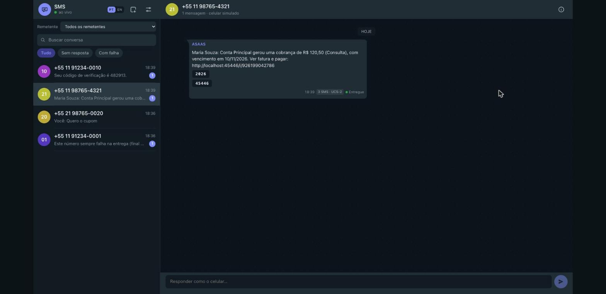
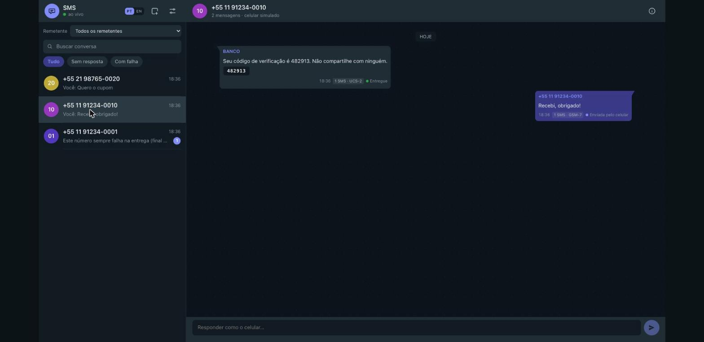
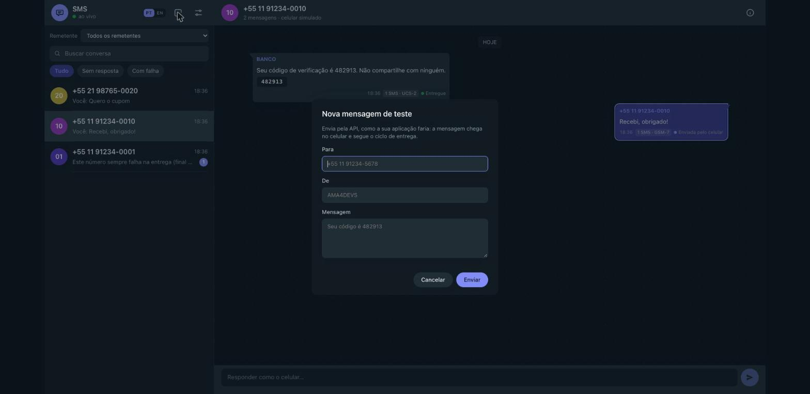
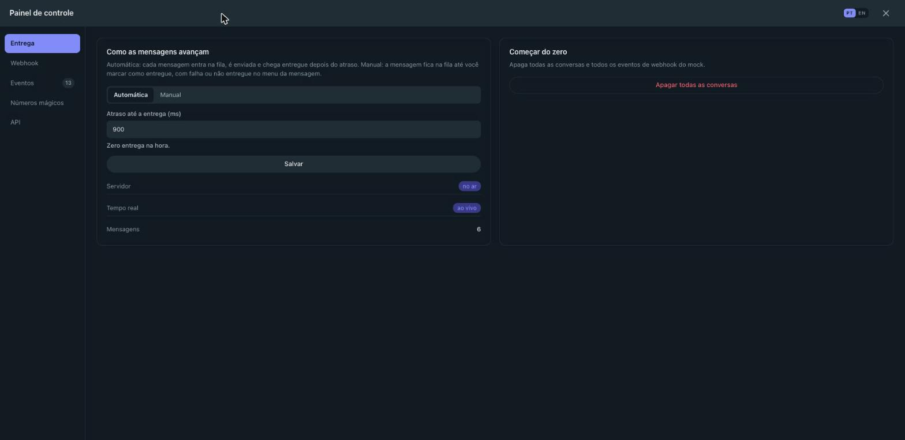
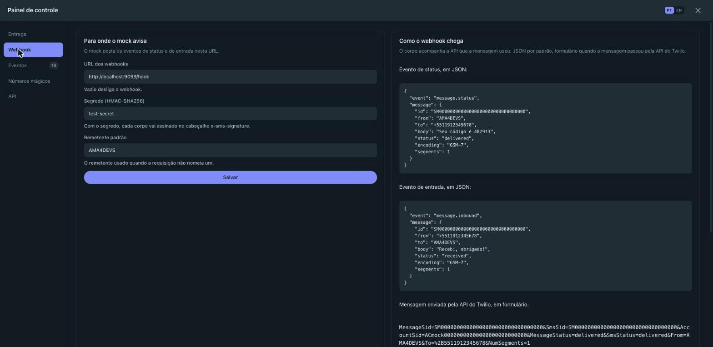
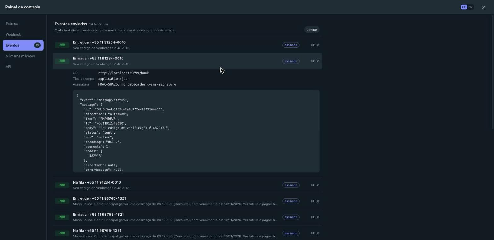
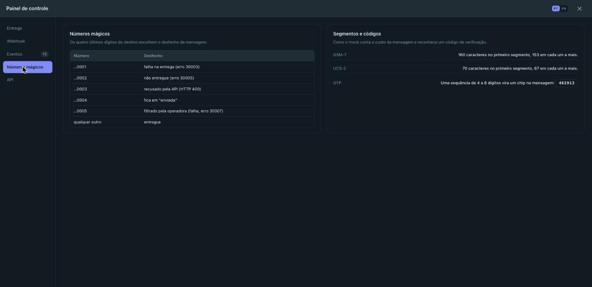
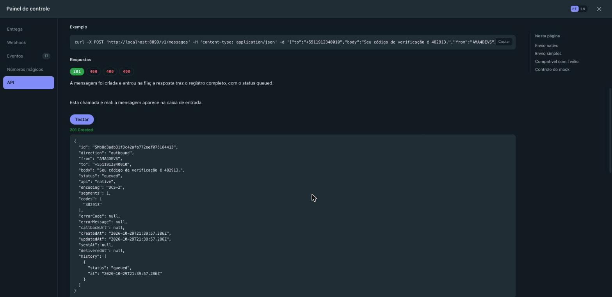

<p align="center"><a href="README.md">English</a> · <b>Português</b> · <a href="https://instituto-ama.github.io/ama4devs/pt-br/sms/">Site da documentação</a></p>

# SMS Mock Server

**Um simulador local de gateway de SMS para desenvolvimento e testes automatizados.** Oferece APIs de envio nativa REST, compatível com Twilio e simples, ciclo de vida realista de entrega de mensagens, webhooks de status e recebimento com assinatura HMAC, números mágicos determinísticos para simulação de falhas de entrega, contagem de segmentos em GSM-7 e UCS-2, extração automática de códigos OTP, suporte a long-polling para testes e um painel de caixa de entrada no celular atualizado em tempo real via WebSockets.

<p align="center">
  
</p>

<p align="center">
  <a href="https://github.com/Instituto-AMA/ama4devs/pkgs/container/sms-mock"></a>
  
  <a href="LICENSE"></a>
</p>

## Início Rápido

Suba o container:

```bash
docker run --rm -p 127.0.0.1:8899:8899 ghcr.io/instituto-ama/sms-mock:latest
```

Ou inicie com o Make na raiz do repositório:

```bash
make up MOCKS=sms
```

Abra o painel do aparelho em [http://localhost:8899](http://localhost:8899). O container escuta na porta `8899`; no repositório, `SMS_PORT` no arquivo `.env` muda a porta no host.

Envie um SMS usando a API nativa:

```bash
curl -s -X POST http://localhost:8899/v1/messages \
  -H 'Content-Type: application/json' \
  -d '{"to": "+5511912340010", "body": "Seu código de verificação é 482913"}'
```

Consulte a mensagem imediatamente, ou aguarde a chegada com long-polling:

```bash
curl -s 'http://localhost:8899/v1/messages?to=%2B5511912340010&wait=3000'
```

## Sobe junto com o mock do Asaas

Neste repositório, o `make up` da raiz (o perfil `asaas` do Compose) sobe o mock de SMS junto com o mock do Asaas, o gerador e o Mailpit. Para deixar o SMS de fora, use `SMS_ENABLED=0` no arquivo `.env`; para subir só ele, use `make up MOCKS=sms`.

O mock do Asaas (versão `0.11.0`) encontra o mock de SMS sozinho: primeiro pelo nome de serviço `sms` do Compose, depois por esta máquina e, por último, pelo host do Docker, na porta `8899`. Ele envia para lá as notificações de SMS do pagador (`POST /v1/messages`, remetente `ASAAS`) nos mesmos eventos de cobrança dos e-mails e das mensagens de WhatsApp, e apenas para clientes com celular cadastrado. Não há nada a configurar.

Uma execução verificada: uma cobrança para "Maria Souza" gerou o SMS

```text
ASAAS → +5511987654321
Maria Souza: Conta Principal gerou uma cobrança de R$ 120,50 (Consulta), com vencimento em 10/11/2026. Ver fatura e pagar: …
```

e ele terminou `delivered` no painel de SMS.

## O Painel

O painel web em `http://localhost:8899` simula a caixa de entrada de um celular de verdade:

- **Uma Conversa por Número:** A barra lateral agrupa as mensagens pelo número de destino, com um seletor de remetente, um campo de busca e os filtros **Tudo**, **Sem resposta** e **Com falha**.
- **As Mensagens da Sua Aplicação:** Chegam como balões à esquerda, com o identificador do remetente, o status da entrega (**Na fila**, **Enviada**, **Entregue**, **Não entregue**, **Falhou**) e a etiqueta de segmentos (`1 SMS · GSM-7`).
- **Chips de Código OTP:** O analisador identifica códigos de verificação de 4 a 8 dígitos e grupos divididos no texto (ex.: `482913`, `123-456`), exibindo botões em chip para cópia com um clique abaixo do corpo da mensagem.
- **Controles Manuais de Status:** Ao passar o mouse sobre a mensagem, aparecem **Entregar**, **Falhar**, **Não entregue** e **Apagar**.
- **Respostas do Aparelho:** Digite no campo de resposta na parte inferior da conversa para responder como o usuário do celular. A resposta aparece à direita, registra uma mensagem recebida (`direction: 'inbound'`, `status: 'received'`) e dispara o webhook de recebimento configurado.
- **Contador de Segmentos em Tempo Real:** Ao digitar no campo de resposta, o contador exibe em tempo real a codificação (`GSM-7` ou `UCS-2`), o tamanho em relação à capacidade do segmento e a quantidade de partes SMS tarifadas (`tamanho/capacidade · codificação · N SMS`).
- **Gaveta de Detalhes:** O ícone de informações no cabeçalho (ou um clique no balão) abre a gaveta com os campos da mensagem, o JSON e o histórico de status.
- **Nova Mensagem de Teste:** O ícone do cabeçalho abre uma janela que envia a mensagem pela API, como a sua aplicação faria.
- **Dois Idiomas:** O cabeçalho alterna o painel entre português do Brasil e inglês.
- **Estado Vazio:** Sem mensagens ainda, o painel oferece **Nova mensagem de teste**, **Carregar exemplos** e **Abrir painel de controle**.
- **Atualizações via WebSocket:** Sincronização em tempo real via `ws://localhost:8899/ws` atualiza conversas, etiquetas de status e registros de webhook sem precisar recarregar a página.

<table>
<tr>
<td width="50%"><br><sub><b>A conversa.</b> Uma mensagem com código OTP em chip copiável, a etiqueta de segmentos, o status da entrega e a resposta do celular à direita.</sub></td>
<td width="50%"><br><sub><b>Nova mensagem de teste.</b> Uma janela que envia a mensagem pela API, como a sua aplicação faria.</sub></td>
</tr>
<tr>
<td width="50%"><br><sub><b>Entrega.</b> Entrega automática ou manual, e o atraso em milissegundos até a mensagem chegar.</sub></td>
<td width="50%"><br><sub><b>Webhook.</b> A URL, o segredo e o remetente padrão, com os formatos de payload e o cabeçalho de assinatura.</sub></td>
</tr>
<tr>
<td width="50%"><br><sub><b>Eventos.</b> Cada tentativa de webhook, com o corpo e o código de status da resposta.</sub></td>
<td width="50%"><br><sub><b>Números mágicos.</b> Os últimos quatro dígitos do destino decidem o desfecho da mensagem.</sub></td>
</tr>
<tr>
<td width="50%"><br><sub><b>API.</b> Uma operação do catálogo expandida, com seus parâmetros, seu curl e a resposta de uma chamada real.</sub></td>
<td width="50%"></td>
</tr>
</table>

## O Painel de Controle

O ícone do cabeçalho abre o painel de controle, uma tela cheia com as abas na lateral:

- **Entrega:** Entrega automática ou manual, o atraso em milissegundos e **Começar do zero**, que apaga todas as conversas e todos os eventos de webhook do mock.
- **Webhook:** A URL do webhook, o segredo, o remetente padrão, os formatos de payload, o cabeçalho `x-sms-signature` e um trecho de Node.js para verificar a assinatura.
- **Eventos:** Cada tentativa de webhook, com o corpo e o código de status da resposta.
- **Números mágicos:** A tabela inteira dos desfechos determinísticos, as capacidades de GSM-7 e UCS-2 e as regras do OTP.
- **API:** As 20 operações do catálogo, expansíveis, com os parâmetros, os campos do corpo, um `curl`, todas as respostas documentadas e um botão **Testar** que envia a requisição de verdade e mostra a resposta.

A [página da API no site da documentação](https://instituto-ama.github.io/ama4devs/pt-br/sms/api/) tem o mesmo catálogo, para leitura.

## APIs de Envio

O mock oferece três interfaces de envio que compartilham o mesmo armazenamento e motor de ciclo de vida:

### 1. API Nativa

Uma interface REST em JSON sob `/v1/messages`.

```bash
curl -X POST http://localhost:8899/v1/messages \
  -H 'Content-Type: application/json' \
  -d '{
    "to": "+5511912340010",
    "body": "Seu pedido #1042 foi enviado.",
    "from": "AMA4DEVS",
    "callbackUrl": "http://127.0.0.1:4000/webhooks/sms"
  }'
```

Retorna `201 Created` com o objeto da mensagem:

```json
{
  "id": "SM01928374a5b6c7d8e9f0123456789abc",
  "direction": "outbound",
  "from": "AMA4DEVS",
  "to": "+5511912340010",
  "body": "Seu pedido #1042 foi enviado.",
  "status": "queued",
  "api": "native",
  "encoding": "GSM-7",
  "segments": 1,
  "codes": [],
  "errorCode": null,
  "errorMessage": null,
  "callbackUrl": "http://127.0.0.1:4000/webhooks/sms",
  "createdAt": "2026-10-29T17:00:00.000Z",
  "updatedAt": "2026-10-29T17:00:00.000Z",
  "sentAt": null,
  "deliveredAt": null,
  "history": [{ "status": "queued", "at": "2026-10-29T17:00:00.000Z" }]
}
```

Endpoints nativos disponíveis:
- `POST /v1/messages`: Cria e enfileira uma mensagem de saída.
- `GET /v1/messages`: Consulta mensagens com filtros (`to`, `from`, `number`, `status`, `direction`, `q`, `limit`, `after`, `wait`).
- `GET /v1/messages/:id`: Obtém uma mensagem específica pelo ID.
- `DELETE /v1/messages/:id`: Remove uma mensagem (`204 No Content`).

### 2. API Compatível com Twilio

Recebe requisições no padrão REST da Twilio sob `/2010-04-01/Accounts/{AccountSid}/Messages.json`. Dados codificados em formulário (`To`, `From`, `Body`, `StatusCallback` ou `MessagingServiceSid`) são processados e retornam a representação de recurso tradicional da Twilio.

```bash
curl -X POST http://localhost:8899/2010-04-01/Accounts/ACmock00000000000000000000000000/Messages.json \
  -u ACmock00000000000000000000000000:mock-auth-token \
  -d "To=+5511912340010" \
  -d "From=AMA4DEVS" \
  -d "Body=Seu codigo e 482913"
```

Para apontar o SDK oficial de Node.js da Twilio para o mock, configure a URL base do cliente:

```javascript
import twilio from 'twilio';

const accountSid = 'ACmock00000000000000000000000000';
const authToken = 'mock-auth-token';

const client = twilio(accountSid, authToken);

// Troca a URL base da Twilio para apontar para o mock local
client.api.baseUrl = 'http://localhost:8899';
// Deixe TWILIO_REGION e TWILIO_EDGE vazias: com qualquer uma delas o SDK reescreve o hostname.

const message = await client.messages.create({
  to: '+5511912340010',
  from: 'AMA4DEVS',
  body: 'Seu código de verificação é 482913',
});

console.log(message.sid, message.status);
```

Endpoints compatíveis com Twilio disponíveis:
- `POST /2010-04-01/Accounts/{AccountSid}/Messages.json`
- `GET /2010-04-01/Accounts/{AccountSid}/Messages.json`
- `GET /2010-04-01/Accounts/{AccountSid}/Messages/{MessageSid}.json`
- `DELETE /2010-04-01/Accounts/{AccountSid}/Messages/{MessageSid}.json`

### 3. API Simples

Uma interface de rota única que aceita `GET` e `POST` em `/sms/send`:

```bash
# Via parâmetros de busca GET:
curl "http://localhost:8899/sms/send?to=%2B5511912340010&message=Aviso+rapido&sender=AMA4DEVS"

# Ou via POST com JSON ou formulário:
curl -X POST http://localhost:8899/sms/send \
  -H 'Content-Type: application/json' \
  -d '{"to": "+5511912340010", "message": "Aviso rapido", "sender": "AMA4DEVS"}'
```

Retorna `200 OK`:

```json
{
  "status": "ok",
  "id": "SM01928374a5b6c7d8e9f0123456789abc",
  "to": "+5511912340010",
  "segments": 1
}
```

Nomes de campos aceitos como sinônimos: `message`, `text` ou `body`; `sender` ou `from`.

## Ciclo de Vida e Números Mágicos

Mensagens de saída seguem um ciclo de vida assíncrono: `queued` → `sent` → `delivered` (ou um status final de falha).
- Por padrão, as transições ocorrem ao longo de `SMS_DELIVERY_DELAY_MS` (padrão `1500` ms). A mensagem atinge `sent` em 1/3 do atraso (`500` ms) e conclui a entrega no tempo total (`1500` ms).
- Configurar `SMS_DELIVERY_DELAY_MS=0` executa todas as transições de forma síncrona na criação.
- Desativar a entrega automática (`SMS_AUTO_DELIVER=0`) mantém as mensagens no estado `queued` até serem avançadas manualmente via API de controle ou painel web.

### Tabela de Números Mágicos

É possível testar cenários de erro de forma determinística configurando os últimos 4 dígitos do número de telefone de destino:

| Sufixo | Resultado | Status Final | Código de Erro | Status HTTP | Comportamento |
|---|---|---|---|---|---|
| `...0001` | `failed` | `failed` | `30003` | 201 | Passa para `sent` e falha com código de operadora 30003 (*Destinatário inacessível*). |
| `...0002` | `undelivered` | `undelivered` | `30005` | 201 | Passa para `sent` e marca como não entregue com código 30005 (*Destinatário desconhecido*). |
| `...0003` | `rejected` | — | `21211` | 400 | Rejeitada imediatamente no envio com HTTP 400 (`rejected_number` / 21211 *Número de telefone inválido*). |
| `...0004` | `stuck` | `sent` | — | 201 | Avança para `sent` e permanece presa nesse estado indefinidamente (simula recibo perdido). |
| `...0005` | `filtered` | `failed` | `30007` | 201 | Passa para `sent` e falha com código 30007 (*Mensagem filtrada pela operadora*). |
| *qualquer outro* | `normal` | `delivered` | — | 201 | Processamento normal: `queued` → `sent` → `delivered`. |

### Contagem de Segmentos

O motor de mensagens analisa a codificação do texto e calcula as partes tarifadas de SMS:
- **GSM-7:** Alfabeto padrão de 128 caracteres mais 9 caracteres da tabela de extensão (`^`, `{`, `}`, `\`, `[`, `]`, `~`, `|`, `€`, contando 2 caracteres cada). A capacidade de uma mensagem única é de **160** caracteres; mensagens com mais de 160 caracteres são divididas em partes de **153** caracteres.
- **UCS-2:** Ativado automaticamente sempre que o texto contiver qualquer caractere fora do conjunto GSM-7 (como emojis ou caracteres acentuados ausentes no GSM 03.38). A capacidade de uma mensagem única é de **70** unidades UTF-16; mensagens divididas usam partes de **67** unidades.

### Extração de Códigos OTP

O corpo da mensagem é verificado automaticamente em busca de códigos de validação:
- Sequências de 4 a 8 dígitos isolados (ex.: `482913`).
- Dígitos agrupados com separadores (ex.: `123-456`, `123 456`).
- Os códigos extraídos alimentam o array `codes` e são renderizados como chips de ação com cópia no painel.

## Webhooks

O mock envia requisições HTTP para notificações de mudança de status e respostas recebidas do aparelho.
- O destino do webhook é obtido a partir do `callbackUrl` da mensagem (por mensagem), recorrendo a `SMS_WEBHOOK_URL` (padrão global) quando ausente.
- Respostas do aparelho sempre são enviadas para `SMS_WEBHOOK_URL`.

### Formatos de Payload

- **APIs Nativa e Simples:** Envia um corpo em JSON:
  ```json
  {
    "event": "message.status",
    "message": {
      "id": "SM01928374a5b6c7d8e9f0123456789abc",
      "direction": "outbound",
      "from": "AMA4DEVS",
      "to": "+5511912340010",
      "body": "Seu código de verificação é 482913",
      "status": "delivered",
      "api": "native",
      "encoding": "GSM-7",
      "segments": 1,
      "codes": ["482913"],
      "errorCode": null,
      "errorMessage": null,
      "callbackUrl": null,
      "createdAt": "2026-10-29T17:00:00.000Z",
      "updatedAt": "2026-10-29T17:00:01.500Z",
      "sentAt": "2026-10-29T17:00:00.500Z",
      "deliveredAt": "2026-10-29T17:00:01.500Z",
      "history": [
        { "status": "queued", "at": "2026-10-29T17:00:00.000Z" },
        { "status": "sent", "at": "2026-10-29T17:00:00.500Z" },
        { "status": "delivered", "at": "2026-10-29T17:00:01.500Z" }
      ]
    }
  }
  ```
- **API Compatível com Twilio:** Envia campos no formato `application/x-www-form-urlencoded` (`MessageSid`, `SmsSid`, `AccountSid`, `MessageStatus`, `SmsStatus`, `From`, `To`, `NumSegments`, `ErrorCode`, `ErrorMessage` e `Body` no recebimento).

### Verificação de Assinatura

Quando `SMS_WEBHOOK_SECRET` estiver configurado, os webhooks de saída incluem o cabeçalho:
```http
x-sms-signature: sha256=<hex-hmac>
```

Exemplo de verificação em Node.js:

```javascript
import crypto from 'node:crypto';

export function verifySmsWebhook(rawBody, signatureHeader, secret) {
  if (!signatureHeader || !signatureHeader.startsWith('sha256=')) {
    return false;
  }
  const providedHash = signatureHeader.slice('sha256='.length);
  const expectedHash = crypto
    .createHmac('sha256', secret)
    .update(rawBody)
    .digest('hex');

  const providedBuf = Buffer.from(providedHash, 'hex');
  const expectedBuf = Buffer.from(expectedHash, 'hex');

  if (providedBuf.length !== expectedBuf.length) {
    return false;
  }
  return crypto.timingSafeEqual(providedBuf, expectedBuf);
}
```

## Testes com Long-Polling

Testes automatizados podem dispensar pausas arbitrárias (`sleep`) consultando a listagem com `wait=<milissegundos>`:

```bash
curl -s 'http://localhost:8899/v1/messages?to=%2B5511912340010&wait=5000'
```

- Se mensagens correspondentes já existirem no armazenamento, o endpoint responde imediatamente com HTTP 200.
- Se nenhuma correspondência existir no momento, a conexão permanece aberta até que uma mensagem correspondente aos critérios (`to`, `from`, `number`, `status`, `direction`, `q`, `after`) seja criada ou mude até combinar com o filtro (ex.: `status=delivered`), ou até o tempo limite de `wait` milissegundos se esgotar (limitado ao máximo de 30.000 ms).
- Se o tempo limite expirar sem ocorrências, uma lista vazia é retornada (`{"messages": [], "count": 0}`).

## Rotas de Controle

Rotas administrativas ficam sob `/_mock/sms/` e são protegidas contra origens não autorizadas:

| Método & Rota | Descrição |
|---|---|
| `GET /_mock/sms/settings` | Lê as configurações atuais (`deliveryDelayMs`, `autoDeliver`, `webhookUrl`, `webhookSecret`, `defaultFrom`). |
| `PUT /_mock/sms/settings` | Atualiza configurações em execução; transmite `settings.updated` para os painéis conectados. |
| `POST /_mock/sms/inbound` | Simula resposta enviada pelo aparelho (`{"from": "+5511912340010", "body": "Confirmado"}`). Dispara webhook de recebimento. |
| `POST /_mock/sms/messages/:id/status` | Altera manualmente o status de uma mensagem de saída (`{"status": "delivered", "errorCode": null}`). |
| `POST /_mock/sms/reset` | Remove todas as mensagens e histórico de webhooks da memória (`204 No Content`). |
| `GET /_mock/sms/webhooks/deliveries` | Lista as tentativas recentes de envio de webhook (até 200, mais recentes primeiro). |
| `DELETE /_mock/sms/webhooks/deliveries` | Limpa o histórico de tentativas de webhook (`204 No Content`). |
| `POST /_mock/sms/demo` | Popula a caixa de entrada com dados de exemplo (código OTP, aviso de envio, promoção UCS-2, falha de operadora, resposta do usuário). |

## Configuração

Configure o mock através de variáveis de ambiente:

| Variável | Padrão | Descrição |
|---|---|---|
| `PORT` | `8899` | Porta HTTP em que o servidor escuta. |
| `MOCK_ALLOWED_HOSTS` | `""` | Lista separada por vírgulas de cabeçalhos `Host` adicionais aceitos pelo guard local. |
| `SMS_WEBHOOK_URL` | `""` | URL padrão para entrega de webhooks de status e recebimento. |
| `SMS_WEBHOOK_SECRET` | `""` | Segredo HMAC-SHA256 para assinatura do cabeçalho `x-sms-signature`. |
| `SMS_DELIVERY_DELAY_MS` | `1500` | Duração em ms da transição de `queued` até `delivered` (0 para síncrono). |
| `SMS_AUTO_DELIVER` | `1` | Avanço automático do ciclo de vida das mensagens (`1` = ativado, `0` = pausa em `queued`). |
| `SMS_DEFAULT_COUNTRY_CODE` | `55` | Código de país padrão prefixado em números sem código internacional. |
| `SMS_DEFAULT_FROM` | `AMA4DEVS` | Identificador de remetente padrão quando a requisição não informa `from`. |
| `SMS_MAX_MESSAGES` | `5000` | Limite de mensagens mantidas em memória antes do descarte das mais antigas. |
| `WEBHOOK_LOCALHOST_REWRITE` | `""` | Reescreve destinos de webhook locais (`localhost`, `127.0.0.1`) para outro host (ex.: `host.docker.internal`). |

## O Guard Local

Para garantir a segurança durante o desenvolvimento local e a execução de testes, todas as rotas exceto `/health` validam o cabeçalho `Host`. Os métodos que mudam o estado (`POST`, `PUT`, `PATCH`, `DELETE`), o handshake de `/ws` e `GET /sms/send` também recusam uma `Origin` estrangeira ou uma requisição de navegador entre sites (`Sec-Fetch-Site: cross-site`):
- Hosts aceitos por padrão: `localhost`, `127.0.0.1`, `::1`, `host.docker.internal`, `sms` e `sms-mock`.
- Hosts adicionais (como aliases de serviço no Docker Compose) podem ser informados em `MOCK_ALLOWED_HOSTS`.
- Requisições pré-voo de CORS (`OPTIONS`) e chamadas de origens permitidas refletem a origem e fornecem cabeçalhos padrão.

## Limitações

- **Armazenamento em Memória:** Todas as mensagens, conversas e registros de webhook residem exclusivamente na memória RAM. Reiniciar o servidor ou container redefine completamente os dados.
- **Sem Envio Real:** O mock opera de forma 100% simulada; nenhuma operadora de telefonia móvel ou rede celular é acionada.
- **Sem Validação de Chave de API:** Qualquer cabeçalho `Authorization`, token Bearer ou credencial Basic auth da Twilio é aceito sem verificação de credenciais.

## Desenvolvimento

Execute os testes:

```bash
bun test
```

Inicie o servidor de desenvolvimento com monitoramento de alterações:

```bash
bun src/server.ts
# ou
bun dev
```

Execute a checagem de tipos com o compilador TypeScript:

```bash
bun run typecheck
```
