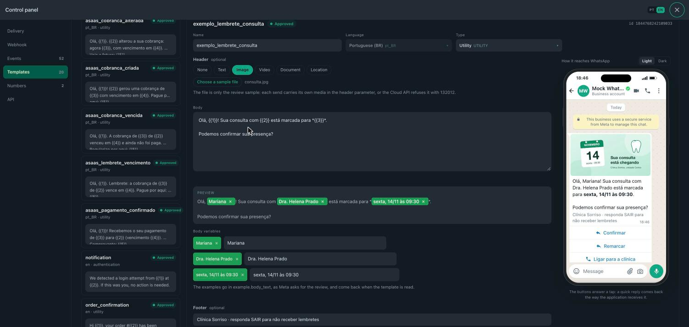
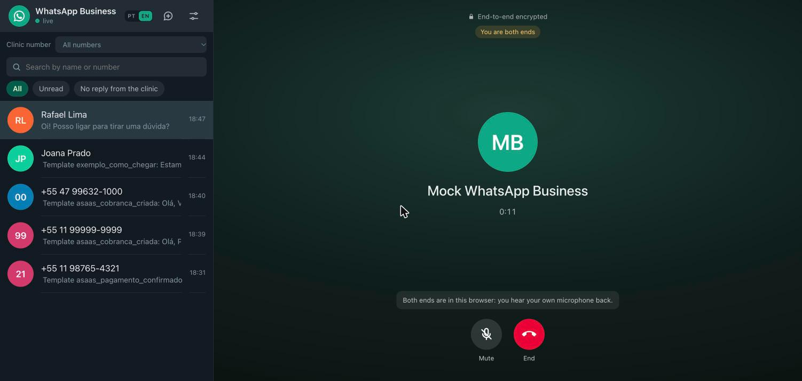
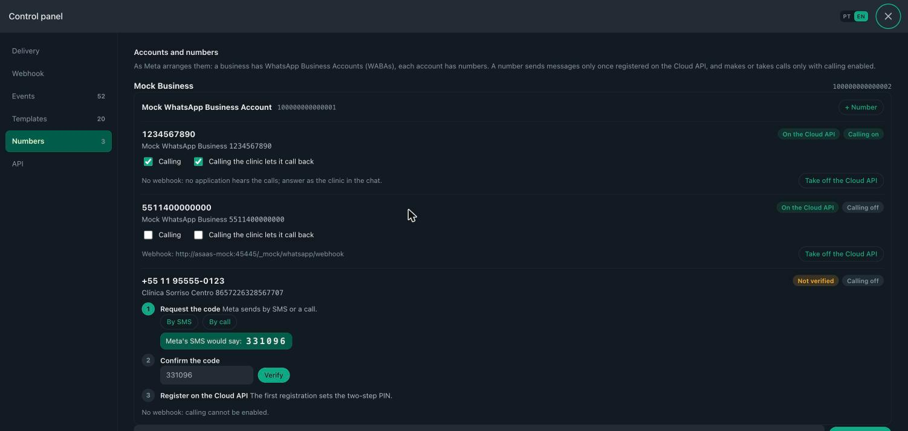
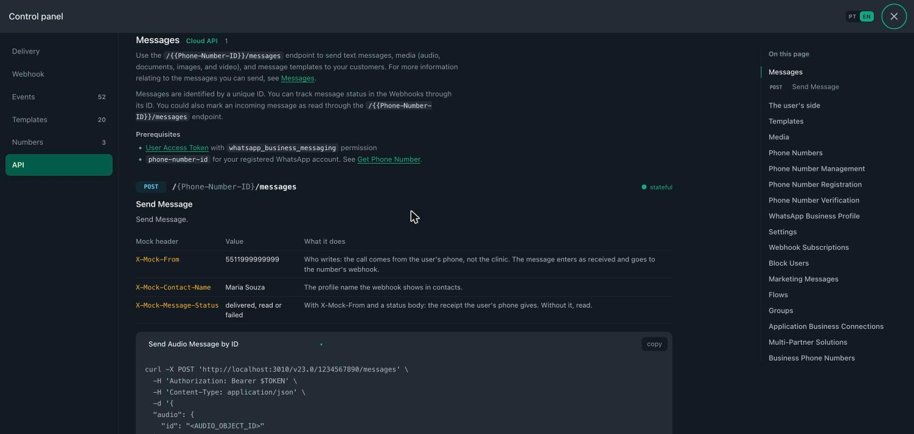
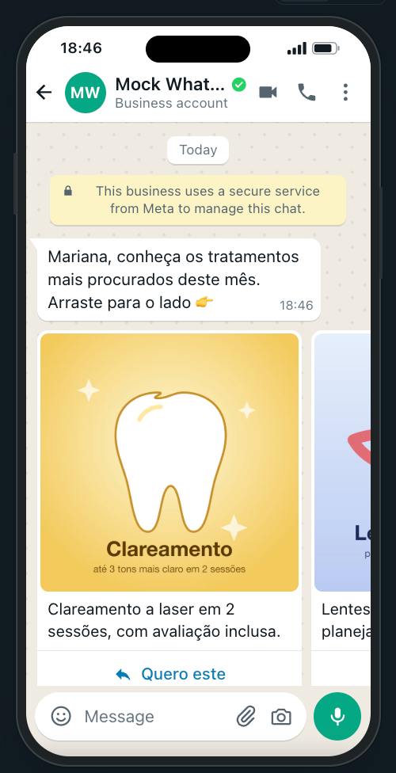

<p align="center"><a href="README.md">English</a> · <b>Português</b></p>

# WhatsApp Mock Server

**Uma WhatsApp Cloud API local**: a Meta Graph API v23.0 da WhatsApp Business
Platform, simulada operação por operação a partir da especificação OpenAPI da
própria Meta. Mensagens, templates, mídia, ligações de voz, números e webhooks,
mais um painel no estilo WhatsApp Web em que você é o usuário do outro lado da
conversa.

<p align="center">
  <a href="https://github.com/Instituto-AMA/ama4devs/pkgs/container/whatsapp-mock"></a>
  
  
  <a href="LICENSE"></a>
</p>

<p align="center">
  
</p>

```bash
docker run --rm -p 3010:3010 ghcr.io/instituto-ama/whatsapp-mock:latest
```

Abra **http://localhost:3010** para ver o painel e aponte a base da Graph API da
sua aplicação para **http://localhost:3010** no lugar de
`https://graph.facebook.com`. Nada mais muda: mesmos caminhos, mesmos corpos,
mesmas respostas, mesmos códigos de erro.

## Por quê

Testar uma integração com WhatsApp na Meta exige número de telefone de verdade,
empresa verificada, templates aprovados, URL pública para o webhook e conta a
pagar por conversa. E mesmo assim você não consegue fazer o usuário responder,
atender uma ligação ou ter um template recusado na hora que precisa.

Este mock dá tudo isso no `localhost`:

- **Fiel por construção.** O arquivo OpenAPI da Meta para a v23.0 está no
  repositório, em [`spec/v23.0`](spec/README.md). Toda chamada é roteada e
  validada por ele, toda resposta segue os schemas de resposta, e um teste de
  contrato passa **todos os exemplos de requisição da especificação da Meta**
  pelo mock. Onde a especificação da Meta contradiz os próprios exemplos da
  Meta, a correção fica escrita com o motivo
  ([`errata.json`](spec/v23.0/errata.json)).
- **Os dois lados da conversa.** Sua aplicação envia pela Cloud API; o usuário
  responde pelo painel (ou pelos seus testes, com um header), e a resposta
  chega no seu webhook exatamente como a Meta entrega.
- **Estado que se comporta.** Templates passam por revisão (aprovado,
  rejeitado, pausado, com motivo e webhook de status), mensagens vão de enviada
  a entregue a lida, um número precisa estar registrado para enviar, uma
  ligação precisa da permissão do usuário.
- **Nada para configurar.** Ele já sobe com uma empresa, uma conta do WhatsApp
  Business e um número registrado com ligações ativas.

## O que ele simula

| Área | Cloud API | O que acontece |
|---|---|---|
| Mensagens | `POST /{phone-number-id}/messages` | Texto, mídia, localização, contatos, interativas, reações, respostas, templates (cabeçalho, corpo, rodapé, botões, carrossel, oferta relâmpago, autenticação). Recibos `enviada → entregue → lida`, indicador de digitação. |
| O usuário | a mesma chamada com `X-Mock-From` | O usuário escreve, responde, manda mídia e áudio de voz, dá os recibos: a mensagem entra como recebida e vai para o seu webhook. |
| Templates | `/{waba-id}/message_templates`, `/{template-id}` | Criar, editar, apagar, listar. Revisão com o veredito e o tempo que você escolher, o webhook `message_template_status_update`, os erros de envio da Meta (`132001`, `132000`, `132012`…). |
| Mídia | `/{phone-number-id}/media`, `/{media-id}` | Upload (multipart, tipos e limites da Meta), consulta, download com token, exclusão. Os arquivos ficam em disco. |
| Números | `/{waba-id}/phone_numbers`, `request_code`, `verify_code`, `register`, `settings` | Empresa → WABAs → números, a ativação de um número novo (o código do SMS aparece no painel), PIN de duas etapas, configuração de ligações. Número não registrado não envia (`133010`). |
| Ligações | `POST /{phone-number-id}/calls`, `call_permissions` | A Calling API com **áudio WebRTC de verdade**: o usuário liga para a empresa ou a empresa liga para o usuário, com pedido e resposta de permissão, `pre_accept`, `accept`, `reject`, `terminate` e os webhooks `calls`. |
| Webhooks | `POST /{phone-number-id}` (`webhook_configuration`) | Endereço por número verificado com `hub.challenge`, assinado com `x-hub-signature-256`, atraso de resposta opcional e registro de cada tentativa. |
| O resto | todo o restante da especificação | Roteado, validado e respondido com o exemplo da própria Meta (Flows, grupos, perfil comercial, QR codes…). |

## O painel

<table>
<tr>
<td width="50%"><br><sub><b>Editor de templates.</b> Cabeçalho (texto, imagem, vídeo, documento, localização), corpo com exemplos, rodapé, todos os tipos de botão, carrossel. O celular à direita mostra como o WhatsApp vai desenhar.</sub></td>
<td width="50%"><br><sub><b>Ligações de voz.</b> Áudio WebRTC de verdade com o seu microfone. Ligue para a empresa como usuário, ligue para o usuário como empresa, ou atenda de qualquer um dos lados.</sub></td>
</tr>
<tr>
<td width="50%"><br><sub><b>Contas e números.</b> Crie um número, receba o código que a Meta mandaria por SMS, verifique, registre com PIN, ative as ligações.</sub></td>
<td width="50%"><br><sub><b>Referência da API.</b> Cada operação da Cloud API v23.0 com um curl pronto para copiar, os headers de teste e um sumário que acompanha a leitura.</sub></td>
</tr>
</table>

<p align="center">
  
  
</p>

O painel fala **português e inglês** (troca no cabeçalho) e não tem rota
privada: toda ação é a chamada da Cloud API que sua aplicação faria, ou uma
chamada `/settings` para o que a Meta não tem endpoint.

## Use no seu projeto

```yaml
services:
  whatsapp:
    image: ghcr.io/instituto-ama/whatsapp-mock:latest   # ou fixe uma versão: 0.4.1
    ports:
      - '3010:3010'
    environment:
      # Para onde o mock entrega os webhooks (sua aplicação).
      WEBHOOK_URL: http://host.docker.internal:4000/webhooks/whatsapp
      # Assina cada webhook com x-hub-signature-256, como o app secret da Meta.
      WEBHOOK_SECRET: my-app-secret
      # Dentro do container, localhost é o próprio container: isto manda para a sua máquina.
      WEBHOOK_LOCALHOST_REWRITE: host.docker.internal
    extra_hosts:
      - 'host.docker.internal:host-gateway'   # Linux
    volumes:
      - whatsapp-data:/app/data               # conversas, templates, números, mídia
volumes:
  whatsapp-data:
```

Qualquer `Authorization: Bearer <token>` é aceito, desde que exista (a Meta
recusa a chamada sem ele, e o mock também).

```bash
# Sua aplicação envia um template…
curl -X POST http://localhost:3010/v23.0/1234567890/messages \
  -H 'Authorization: Bearer test' -H 'Content-Type: application/json' \
  -d '{"messaging_product":"whatsapp","to":"5511999999999","type":"template",
       "template":{"name":"order_confirmation","language":{"code":"en"},
         "components":[{"type":"body","parameters":[
           {"type":"text","text":"Maria"},{"type":"text","text":"1042"},{"type":"text","text":"29.90"}]}]}}'

# …e o usuário responde (num teste, ou pelo painel).
curl -X POST http://localhost:3010/v23.0/1234567890/messages \
  -H 'Authorization: Bearer test' -H 'Content-Type: application/json' \
  -H 'X-Mock-From: 5511999999999' -H 'X-Mock-Contact-Name: Maria Souza' \
  -d '{"messaging_product":"whatsapp","type":"text","text":{"body":"Oi!"}}'
```

## Headers de teste

O que só um teste precisa vai em headers opcionais, nunca no corpo, para que o
corpo continue sendo o que a Cloud API espera:

| Header | Em | O que faz |
|---|---|---|
| `X-Mock-From` | `POST /{phone}/messages`, `/calls` | A chamada vem do celular do usuário: uma mensagem, um recibo, uma ligação. |
| `X-Mock-Contact-Name` | idem | O nome do perfil que o seu webhook recebe. |
| `X-Mock-Message-Status` | um recibo de leitura com `X-Mock-From` | `delivered`, `read` ou `failed`. |
| `X-Mock-Template-Review` | criar e editar template | `APPROVED` (padrão), `REJECTED`, `PAUSED`, `DISABLED`, `PENDING`. |
| `X-Mock-Template-Review-Reason` | idem | O motivo da rejeição. |
| `X-Mock-Template-Review-Delay` | idem | Quanto a revisão demora, em ms. |
| `X-Mock-Skip-Callback-Verification` | endereço de webhook | Aceita a URL sem a verificação `hub.challenge`. |

## Configuração

| Variável | Padrão | |
|---|---|---|
| `PORT` | `3010` | Porta HTTP |
| `WEBHOOK_URL` | *(vazio)* | Webhook padrão; `numero:url` direciona um número |
| `WEBHOOK_SECRET` | *(vazio)* | Assina os webhooks com `x-hub-signature-256` |
| `WEBHOOK_LOCALHOST_REWRITE` | *(vazio)* | Host que substitui `localhost` nas URLs de webhook (`host.docker.internal`) |
| `MOCK_WEBHOOK_RESPONSE_DELAY_MS` | `5000` | Espera antes de cada entrega de webhook (também no painel) |
| `MOCK_DELIVERY_MODE` | `auto` | `manual`: os tiques só andam quando o celular do usuário dá o recibo |
| `MOCK_TEMPLATE_REVIEW_DELAY_MS` | `2000` | Duração padrão da revisão de um template |
| `WHAP_CALL_RING_MS` | `60000` | Quanto tempo uma ligação toca antes de terminar sem resposta |
| `WHAP_DATA_DIR` | `./data` (`/app/data` na imagem) | Banco SQLite e arquivos de mídia |
| `WHAP_DB` | *(arquivo)* | `:memory:` não guarda nada |
| `MOCK_PHONE_NUMBER_ID` · `MOCK_WABA_ID` · `MOCK_BUSINESS_ID` | `1234567890` · `100000000000001` · `100000000000002` | Os ids do número, da WABA e da empresa padrão |
| `MOCK_ALLOWED_HOSTS` | *(vazio)* | Nomes de `Host` extras aceitos (o nome de um serviço do compose) |

Templates também podem vir de arquivos: cada JSON em `templates/` é importado
na subida e quando muda, e `templates/examples/` traz um exemplo de cada
componente que a Meta permite ([docs/templates.md](docs/templates.md)).

## Documentação

- [docs/panel.md](docs/panel.md): o painel, ligações, áudios de voz, números, as rotas `/settings`
- [docs/templates.md](docs/templates.md): templates, sementes e exemplos
- [spec/README.md](spec/README.md): a especificação da Meta e a errata

## Desenvolvimento

```bash
bun install
bun run src/index.ts server          # http://localhost:3010
bun --bun vitest run --maxWorkers=2  # testes, incluindo o teste de contrato
bun tsc --noEmit
```

Uma nova versão da Graph API é uma nova pasta `spec/<versão>` e uma entrada em
`src/graph/versions.ts`; o teste de contrato roda todas as versões.

## Licença

Apache-2.0, veja [LICENSE](LICENSE). A especificação OpenAPI da Meta em `spec/`
é MIT, Copyright (c) Meta Platforms, Inc. and affiliates.

**Sem vínculo com a Meta ou o WhatsApp.** Este é um simulador independente da
API pública deles, para desenvolvimento local e testes. WhatsApp e Meta são
marcas de seus respectivos donos.
